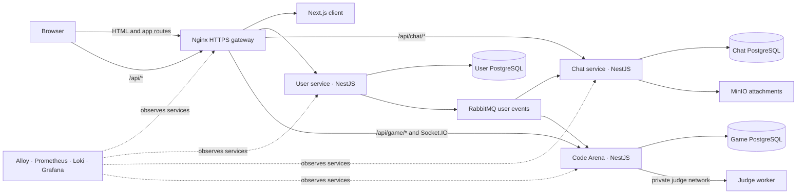

# Nook

## Description

Nook is a community platform for the 1337 / 42 student community. It brings profiles, friendships, a feed, conversations and games into one web app. This repository contains the Next.js client, User and Chat services, Code Arena game service, judge worker, databases, storage, gateway and monitoring stack.

The current playable game is **Code Arena**: authenticated 1v1 and 2v2 programming matches with timed rounds, server-side scoring, matchmaking and private rooms. The 2v2 mode has a shared editor and team chat. Players can challenge someone from a direct conversation or profile, then open the invitation in the Play area. Match history, win/loss statistics, a leaderboard, XP, levels, rank titles and six unlockable achievements are available. The leaderboard is based on wins and win rate; this build does not have an Elo rating.

## 42 curriculum attribution and team

The subject requires the very first README line to be italicized and follow this wording: “This project has been created as part of the 42 curriculum by &lt;login1&gt;[, &lt;login2&gt;[, &lt;login3&gt;[...]]].” The team must supply confirmed 42 logins and place the completed attribution before the title; no member names have been inferred. See [the subject](ft_trans_subject.pdf), Chapter VI.

The team roster and role assignments have not been reconfirmed in this repository. These responsibilities describe the expected roles, but do not assign them to individuals:

| Role | Responsibility | Assigned team member |
|---|---|---|
| Product Owner (PO) | Set user needs, scope, priorities and acceptance criteria | Not confirmed |
| Project Manager / Scrum Master (PM) | Maintain the plan, coordinate work and track risks and progress | Not confirmed |
| Technical Lead | Own architecture, interfaces, integration and technical review | Not confirmed |
| Developers | Implement features, tests, documentation and demonstrations | Not confirmed |

Individual contributions and Git-history evidence must be mapped to the confirmed roster before submission. The project plan is in [the points roadmap](docs/project/POINTS_ROADMAP.md); the current product context and open decisions are in [Project Context](docs/project/PROJECT_CONTEXT.md).

## Architecture



Nginx is the browser-facing HTTPS entry point. Service and database ports are private to the Compose network, apart from the explicitly loopback-bound development tools below. User owns account identity and authentication; Chat owns messages and groups; Code Arena owns matches, rounds, submissions and collaboration snapshots. The services use separate PostgreSQL databases. RabbitMQ propagates account profile and deletion events to Chat, and account deletion events to Game. MinIO stores Chat attachments. Code Arena sends evaluations to the judge worker over a dedicated internal Docker network. The worker runs submitted code in resource-limited containers without network access. Judge concurrency and waiting work are bounded by the judge process; Postgres stores durable match and submission records.

The judge worker currently mounts the host Docker socket because it creates the isolated execution containers. Treat that worker as a privileged host component: keep the worker endpoint and shared token private, and review the Docker-host trust boundary before using this setup for an untrusted public multi-tenant service.

## Stack and why

| Area | Technology | Use in Nook |
|---|---|---|
| Web client | Next.js App Router, React, TypeScript, Tailwind CSS | Shared application, public pages, server-rendered routes, accessible responsive components |
| Backend services | NestJS, Node.js, TypeScript | Separate account, chat and game boundaries with validated APIs and WebSocket gateways |
| Account and Chat persistence | PostgreSQL and Prisma | Relational identity/social data and conversation/group data with migrations |
| Game persistence | PostgreSQL with parameterized SQL | Atomic match snapshots, round/submission records and collaborative state |
| Realtime | Socket.IO, Yjs | Presence, chat, matchmaking and collaborative 2v2 editing |
| Service events | RabbitMQ | Profile synchronization to Chat and account deletion delivery to Chat and Game |
| Attachments | MinIO | Private object storage with presigned browser uploads/downloads |
| Code execution | Judge worker and Docker | Isolated execution of Code Arena submissions |
| Local orchestration | Docker Compose | Repeatable multi-service development and demonstration |
| Gateway and monitoring | Nginx, Grafana, Prometheus, Loki, Alloy | TLS termination, path routing, health/metrics dashboards and operational logs |

## Instructions: start the local stack

**Prerequisites:** Docker with Compose, Node.js 22 or newer for repository scripts, and a browser with local HTTPS certificate acceptance. Full first-start configuration is documented in [Environment configuration](envs/README.md) and [Local Compose setup](docs/project/COMPOSE.md).

On a fresh clone, create the ignored local environment files from the templates, then replace every `<...>` value with a real local setting. Do not commit the resulting files. The template values are not runnable credentials.

```sh
for example in envs/*.env.example; do cp "$example" "${example%.example}"; done
```

Generate the User service JWT key pair and put both keys in `envs/user-auth.env`. Copy only the matching public key to `envs/chat-service.env` and `envs/game-service.env`; Game must never receive the private signing key. Set the Game DB credentials in `envs/game-db.env` and match them in `envs/game-service.env`'s `DATABASE_URL`. Generate one strong judge token and use that same value in `envs/game-service.env` and `envs/judge-worker.env`. Configure the required SMTP, database, RabbitMQ, MinIO and Grafana settings. OAuth provider credentials are optional, but each enabled provider needs the matching HTTPS callback registration. See the environment guide for the exact fields and setup order.

Check configuration, then build and start the services:

```sh
docker compose config --quiet
docker compose up --build
```

Open **https://localhost** and accept or trust the development certificate generated by Nginx. The default development certificate is self-signed and is not suitable for a public deployment. Compose persists application data in local bind-mounted directories and named monitoring volumes; `docker compose down` stops the stack but keeps that data.

| Local address | Service |
|---|---|
| `https://localhost` | Nook web application and API gateway |
| `https://localhost/grafana/` | Login-protected Grafana dashboards |
| `https://localhost:9443` | Loopback-bound MinIO S3 proxy for browser attachments |
| `http://localhost:9001` | Loopback-bound MinIO console |
| `http://localhost:15672` | Loopback-bound RabbitMQ management console |

Prometheus, Loki, Alloy, databases, backend services and the judge worker are not published as public ports. Default admin credentials are set by the local environment files; the repository does not ship usable credentials.

## Data model overview

| Store | Owned information | Access path |
|---|---|---|
| User PostgreSQL | Accounts, profile fields and images, auth providers, hashed credentials, sessions/tokens, friendships, blocks and recovery/2FA records | User service, Prisma migrations |
| Chat PostgreSQL | Cached user profiles, groups/memberships, DMs and channels, messages, reactions and read state | Chat service, Prisma migrations |
| Game PostgreSQL | Private rooms, match snapshots, rounds, submissions, results and collaborative editor snapshots | Code Arena service, SQL schema initialization |
| MinIO | Chat attachment objects | Chat service presigned upload/download flows |

The databases have separate owners and no cross-database foreign keys. The Chat service receives profile changes through RabbitMQ and stores the existing User UUID. MinIO stores Chat attachments. Code Arena sends evaluations to the judge worker over a dedicated internal Docker network. The worker runs submitted code in resource-limited containers without network access. Judge concurrency and waiting work are bounded by the judge process; Postgres stores durable match and submission records. See the [User service guide](docs/services/user-service.md), [Chat schema notes](docs/services/chat-service.md), and [game persistence implementation](packages/arena-game/src/postgres-store.ts).

## Verification

Run `npm run check` for the complete project gate. Setup, disposable integration tests, local secret hooks and CI scope are documented in [Repeatable verification](docs/project/VERIFICATION.md).

## Code Arena integration

- 1v1 matchmaking and private rooms; 2v2 team rooms.
- Three seeded problems selected without repetition for a three-round match.
- Authenticated HTTP and Socket.IO APIs routed through `/api/game/` and `/api/game/socket.io/`.
- Reconnection and presence recovery, server-owned scoring, result reveal and match persistence.
- Collaborative editor and team chat for 2v2.
- Profile and direct-message challenges represented as interactive room invitations.
- Authenticated match summaries, per-user statistics and a leaderboard. Public summaries do not return source code or hidden tests.
- Player names and avatars are loaded from the User service in lobbies.

Invitation cards poll room status every ten seconds, show Open, In Match or Expired, route matched rooms to their match, and disable expired rooms. The Game service enforces joinability. Game retains match records and source submissions until account erasure or the instance operator's retention policy applies; erasure removes affected-side source/editor data and anonymizes retained results. See the [Privacy Policy](/privacy) and [Terms of Service](/terms).

## Module evidence and point calculation

The [ft_transcendence v21.2 subject](ft_trans_subject.pdf) is the requirements source; [the module tracker](docs/requirements/index.html) assigns local IDs such as G01 and U02 for planning. Evaluator decisions are not recorded here. The table below is an evidence map, not a claim that the team has been awarded points. `Maximum` is the module value in the local tracker; assessors decide whether every requirement is met.

| Module | Maximum | Current evidence and remaining condition |
|---|---:|---|
| G01 · Complete web-based game | 2 | Code Arena has playable 1v1/2v2 modes, scoring and outcomes; the three-round Game-service HTTP flow passes. Demonstrate a complete match and explain the rules. |
| G02 · Remote players | 2 | Server-authoritative deadlines, revisioned snapshots, reconnect grace, and visible connection state are covered by engine and real-socket/PostgreSQL restart tests. Demonstrate two clients on separate computers with latency/disconnection recovery. |
| G03 · More than two players | 2 | Four-client 2v2 service/socket tests cover team isolation, collaborative readiness, and reveal delivery. Demonstrate fair synchronized play with all four clients. |
| U01 · User management | 2 | Account, profile, friend and presence flows exist. Verify the full rubric and demonstrate the flows. |
| U02 · Game statistics/history | 1 | Match history, win/loss summaries, leaderboard, player progression (XP, levels, rank titles) and 6 unlockable achievements are implemented and displayed on profile and leaderboard. Demonstrate the flows. |
| W09 · Real-time collaboration | 1 | Code Arena 2v2 implements synchronized multi-user code editing with CodeMirror and Yjs CRDTs over authenticated Socket.IO (`/collab` namespace), with conflict resolution and document revision tracking. |
| G06 · Advanced chat | 1 | Persistent history, bidirectional block enforcement, game invitations, profile access, typing indicators and durable read receipts are implemented, with prior automated and live dual-user verification recorded. Game notifications in chat are now a separate, server-backed path: the Game service publishes authoritative match events and Chat writes match-start, match-result (including forfeit) and cancellation notices into the linked conversation, with automated evidence. Verify them live against subject §IV.6 before claiming the full module. |
| D03 · Backend microservices | 2 | User, Chat, Game and judge responsibilities have separate service boundaries and APIs/events. Demonstrate the service interactions. |
| D04 · Health/status/backups/recovery | 1 | Compose health checks cover all service containers; public `/status` page and `/api/status` endpoint; multi-database (User, Chat, Game) and MinIO snapshot/restore scripts with checksums and retention. Install one operator-managed schedule and demonstrate clean-service recovery; prior live restore smoke checks do not establish that. See [backup guidance](docs/infra/BACKUP_RECOVERY.md). |

No final module total is claimed here. If every listed module were accepted at its maximum, their arithmetic subtotal would be **14 points** (2 + 2 + 2 + 2 + 1 + 1 + 1 + 2 + 1); incomplete modules contribute zero until the team completes and demonstrates their requirements. Reconcile the full project score with the subject and tracker before submission. G06 remains conditional on the separate notification check above. G09 gamification is a candidate outside this subtotal: achievements, leaderboards and XP/levels exist, but database persistence across restart, visual feedback and clear progression rules still need an acceptance demonstration against subject §IV.6.

## Privacy, terms and operational notes

Public pages are available at [Privacy Policy](/privacy) and [Terms of Service](/terms). The current client does not expose self-service account deletion. When account deletion is processed, Chat clears cached profile identity while retaining existing messages. Game removes matchmaking/private-room membership, forfeits unfinished matches, deletes affected-side source, run output, judge diagnostics and collaborative documents, and anonymizes retained results. In 2v2, erasure removes the entire side's shared code. Backups and logs have separate operator-controlled retention. Public deployment requires the instance operator to configure trusted TLS, secrets, hosting, backups, data retention and a reliable contact channel.

## Resources and AI use

We used AI tools openly. The team chose the product, architecture, API contracts, design direction and final behavior. AI-assisted code was reviewed and tested by project members; team members remain responsible for explaining and modifying it.

| Resource/tool | Use |
|---|---|
| Claude Code | Planning, implementation assistance, code review, tests and repository documentation |
| Codex (OpenAI) | Code Arena/Nook integration audit and implementation assistance, fixes, verification and documentation |
| OpenCode / Antigravity | Advanced chat (G06) typing indicators and read receipts implementation, verification, and session continuation; game lifecycle notifications in chat (game event contract and publisher, Chat consumer and correlation checks, client rendering) with tests |
| Graphify | Generated a code relationship map in `graphify-out/` |
| Understand Anything | Generated a repository knowledge graph and codebase tour in `.ua/` |

AI-assisted frontend work includes the Next.js client and design-token/component iterations. AI was also used for selected feature planning, implementation suggestions, tests and documentation. Backend account and chat work was primarily written by the team, with AI used for explanations, reviews and targeted assistance. Review the project team's final AI-use statement and individual contribution list against the actual Git history before submission.

## Verification commands

```sh
npm run build:packages
npm run build --workspace services/game
npm run test --workspace services/game
cd client && npm test && npm run lint && npm run build
cd .. && node nginx/check.mjs
```

The game Postgres restart test needs `TEST_PG_URL`; the in-memory game suite does not exercise the configured deployment database. `nginx/check.mjs` verifies local gateway routing after the stack is running. See [all project documentation](docs/README.md) for service guides, plans, diagrams and setup details.

## Git activity report

Requires Git and Node.js 20+; no dependencies to install. From the repository root:

```sh
node git-analytics.mjs
node git-analytics.mjs --no-fetch
node git-analytics.mjs --branch main
node git-analytics.mjs --json > git-report.json
```

The default command fetches all `origin` branches, prunes stale remote-tracking
refs, and downloads full history for shallow clones. It does not merge, switch
branches, or change working files. Fetch failures stop the report; `--no-fetch`
explicitly uses cached refs instead.

Reports include unique commit counts, authored/co-authored credit per contributor,
7/30-day pulse, 12 weeks of activity, branch history counts, and recent commits.
Contributor counts and pulse exclude merges; merge totals are shown separately.
Activity uses author dates in UTC. `.mailmap` combines known contributor aliases
for both authors and co-authors without rewriting history; add aliases there as
needed. A person is credited once per commit, and shared commits credit each
participant. These counts describe recorded history, not effort or code quality.

Only history reachable from `origin` branches is included, so local backup and
review branches do not inflate totals. Shared commit IDs count once overall;
branch totals overlap. Distinct commits created by cherry-picks or history rewrites
remain distinct. JSON output includes contributor email addresses.
