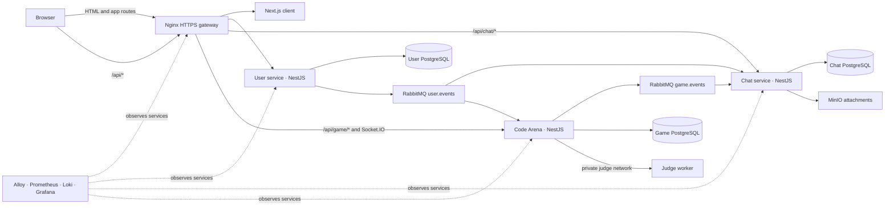

_This project has been created as part of the 42 curriculum by sel-mlil, ayousr, amsbai, elakhfif._

# Nook

## Description

Nook is a community platform that gives students a welcoming place to share what they are thinking and building, connect with one another, and learn through friendly competition. Its feed brings together thoughts, code snippets, images, and videos. Direct messages and group spaces with channels give students places to continue conversations and collaborate.

For coding competitions, **Code Arena** supports 1v1 challenges and 2v2 team matches. Teams can work together in a shared editor and coordinate through in-game chat. Match history, player statistics, a leaderboard, XP, levels, rank titles, and achievements connect competition to longer-term progress. By bringing sharing, conversation, and play into one platform, Nook makes it easier for students to connect around both their interests and their work.

## Team and contributions

| 42 login   | Role(s)                                  | Contributions                                                                                                                                                                                                                                                                                                                                  |
| ---------- | ---------------------------------------- | ---------------------------------------------------------------------------------------------------------------------------------------------------------------------------------------------------------------------------------------------------------------------------------------------------------------------------------------------- |
| `sel-mlil` | Product Owner, Technical Lead, Developer | Proposed the project and selected its technology stack, drawing on prior web and full-stack experience. Built user management and its Next.js client integration; implemented Chat endpoints and client integration, including service integration informed by the RabbitMQ setup. Co-developed infrastructure specifications with `elakhfif`. |
| `ayousr`   | Project Manager, Developer               | Coordinated work through Trello and Discord and helped mediate team tensions. Built the game service and judge server, contributed to 1v1 design decisions, and continued with 2v2 gameplay and client integration.                                                                                                                            |
| `amsbai`   | Developer                                | Helped plan the Chat service and contributed to 1v1 design decisions. The project was also a hands-on learning experience.                                                                                                                                                                                                                     |
| `elakhfif` | Infrastructure / DevOps contributor      | Shared infrastructure guidance from prior experience and helped shape the Nginx routing and Grafana monitoring specifications.                                                                                                                                                                                                                 |

### Team reflection

The project brought together people with different experience levels, work styles, and availability. Workload did not always feel evenly distributed, and deadline pressure and communication gaps sometimes made collaboration difficult. `ayousr` played an important role in calming tensions and helping the team keep moving. This experience taught us to align expectations earlier, make workload visible, and raise blockers before they become deadline problems. Differences in experience also gave the team opportunities to learn from one another.

The project plan is in the [points roadmap](docs/project/POINTS_ROADMAP.md); the current product context and open decisions are in [Project Context](docs/project/PROJECT_CONTEXT.md).

## Architecture



Nginx is the browser-facing HTTPS entry point. Service and database ports are private to the Compose network, apart from the explicitly loopback-bound development tools below. User owns account identity and authentication; Chat owns messages and groups; Code Arena owns matches, rounds, submissions and collaboration snapshots. The services use separate PostgreSQL databases. RabbitMQ carries User account events to Chat and account-deletion events to Game. Game also publishes match and challenge lifecycle events to Chat, which stores them as notices in the conversation that carries an invitation. Delivery is best effort because Game does not keep an outbox for replay after a broker failure. MinIO stores Chat attachments. Code Arena sends evaluations to the judge worker over a dedicated internal Docker network. The worker runs submitted code in resource-limited containers without network access. Judge concurrency and waiting work are bounded by the judge process; Postgres stores durable match and submission records.

The judge worker currently mounts the host Docker socket because it creates the isolated execution containers. Treat that worker as a privileged host component: keep the worker endpoint and shared token private, and review the Docker-host trust boundary before using this setup for an untrusted public multi-tenant service.

## Stack and why

| Area                         | Technology                                          | Use in Nook                                                                                                  |
| ---------------------------- | --------------------------------------------------- | ------------------------------------------------------------------------------------------------------------ |
| Web client                   | Next.js App Router, React, TypeScript, Tailwind CSS | Shared application, public pages, server-rendered routes, accessible responsive components                   |
| Backend services             | NestJS, Node.js, TypeScript                         | Separate account, chat and game boundaries with validated APIs and WebSocket gateways                        |
| Account and Chat persistence | PostgreSQL and Prisma                               | Relational identity/social data and conversation/group data with migrations                                  |
| Game persistence             | PostgreSQL with parameterized SQL                   | Atomic match snapshots, round/submission records and collaborative state                                     |
| Realtime                     | Socket.IO, Yjs                                      | Presence, chat, matchmaking and collaborative 2v2 editing                                                    |
| Service events               | RabbitMQ                                            | Profile synchronization to Chat, account deletion to Chat and Game, and Code Arena lifecycle notices to Chat |
| Attachments                  | MinIO                                               | Private object storage with presigned browser uploads/downloads                                              |
| Code execution               | Judge worker and Docker                             | Isolated execution of Code Arena submissions                                                                 |
| Local orchestration          | Docker Compose                                      | Repeatable multi-service development and demonstration                                                       |
| Gateway and monitoring       | Nginx, Grafana, Prometheus, Loki, Alloy             | TLS termination, path routing, health/metrics dashboards and operational logs                                |

## Instructions: start the local stack

**Prerequisites:** Docker with Compose, Node.js 22 or newer for repository scripts, and a browser with local HTTPS certificate acceptance. Full first-start configuration is documented in [Environment configuration](envs/README.md) and [Local Compose setup](docs/project/COMPOSE.md).

On a fresh clone, create the ignored local environment files from the templates, then replace every `<...>` value with a real local setting. Do not commit the resulting files. The template values are not runnable credentials.

```sh
for example in envs/*.env.example; do cp "$example" "${example%.example}"; done
```

Generate the User service JWT key pair and put both keys in `envs/user-auth.env`. Copy only the matching public key to `envs/chat-service.env` and `envs/game-service.env`; Game must never receive the private signing key. Set the Game DB credentials in `envs/game-db.env` and match them in `envs/game-service.env`'s `DATABASE_URL`. Generate one strong judge token and use that same value in `envs/game-service.env` and `envs/judge-worker.env`. Configure the required SMTP, database, RabbitMQ, MinIO and Grafana settings. OAuth provider credentials are optional, but each enabled provider needs the matching HTTPS callback registration. See the environment guide for the exact fields and setup order.

Check configuration, then build and start the services:

```sh
docker compose config --quiet
docker compose up --build
```

Open **https://localhost** and accept or trust the development certificate generated by Nginx. The default development certificate is self-signed and is not suitable for a public deployment. Compose persists application data in local bind-mounted directories and named monitoring volumes; `docker compose down` stops the stack but keeps that data.

| Local address                | Service                                               |
| ---------------------------- | ----------------------------------------------------- |
| `https://localhost`          | Nook web application and API gateway                  |
| `https://localhost/grafana/` | Login-protected Grafana dashboards                    |
| `https://localhost:9443`     | Loopback-bound MinIO S3 proxy for browser attachments |
| `http://localhost:9001`      | Loopback-bound MinIO console                          |
| `http://localhost:15672`     | Loopback-bound RabbitMQ management console            |

Prometheus, Loki, Alloy, databases, backend services and the judge worker are not published as public ports. Default admin credentials are set by the local environment files; the repository does not ship usable credentials.

## Data model overview

| Store           | Owned information                                                                                                                      | Access path                                   |
| --------------- | -------------------------------------------------------------------------------------------------------------------------------------- | --------------------------------------------- |
| User PostgreSQL | Accounts, profile fields and images, auth providers, hashed credentials, sessions/tokens, friendships, blocks and recovery/2FA records | User service, Prisma migrations               |
| Chat PostgreSQL | Cached user profiles, groups/memberships, DMs and channels, messages, reactions and read state                                         | Chat service, Prisma migrations               |
| Game PostgreSQL | Private rooms, match snapshots, rounds, submissions, results and collaborative editor snapshots                                        | Code Arena service, SQL schema initialization |
| MinIO           | Chat attachment objects                                                                                                                | Chat service presigned upload/download flows  |

The databases have separate owners and no cross-database foreign keys. The Chat service receives profile changes through RabbitMQ and stores the existing User UUID. MinIO stores Chat attachments. Code Arena sends evaluations to the judge worker over a dedicated internal Docker network. The worker runs submitted code in resource-limited containers without network access. Judge concurrency and waiting work are bounded by the judge process; Postgres stores durable match and submission records. See the [User service guide](docs/services/user-service.md), [Chat schema notes](docs/services/chat-service.md), and [game persistence implementation](packages/arena-game/src/postgres-store.ts).

## Verification

Run `npm run check` for the complete project gate. Setup, disposable integration tests, local secret hooks and CI scope are documented in [Repeatable verification](docs/project/VERIFICATION.md).

## Code Arena integration

- 1v1 matchmaking and private rooms; 2v2 team rooms.
- Three seeded problems selected without repetition for a three-round match.
- Authenticated HTTP and Socket.IO APIs routed through `/api/game/` and `/api/game/socket.io/`.
- Reconnection and presence recovery, server-owned scoring, result reveal and match persistence.
- Collaborative editor and team chat for 2v2.
- Profile and direct-message challenges represented as interactive room invitations.
- Authenticated match summaries, per-user statistics and a leaderboard. Public summaries do not return source code or hidden tests.
- Player names and avatars are loaded from the User service in lobbies.

Invitation cards poll room status every ten seconds, show Open, In Match or Expired, route matched rooms to their match, and disable expired rooms. The Game service enforces joinability. Game retains match records and source submissions until account erasure or the instance operator's retention policy applies; erasure removes affected-side source/editor data and anonymizes retained results. See the [Privacy Policy](/privacy) and [Terms of Service](/terms).

## Module coverage and tracker

The team tracks ft_transcendence module coverage against the [42 subject](ft_trans_subject.pdf) and the [local module tracker](docs/requirements/index.html). `sel-mlil` built [FT Trans Score](https://ft-trans-score.vercel.app/) to keep the module counter, evidence, and acceptance status organized during the project.

The team currently claims the **22 modules** in the table below, worth **31 raw points** under the local tracker. `U04` (advanced permissions) is excluded from this claim. The tracker catalog lists 55 modules and 79 raw possible points. Its scoring display has a **14-point required threshold plus up to 5 bonus points**; the bonus is capped even when raw module points exceed 19. Twelve mandatory foundation checks are separate from module points. This is a team coverage calculation, not an evaluator award; evaluators decide whether each requirement is met. See the [submission gate and foundation requirements](docs/project/POINTS_ROADMAP.md#submission-gate--foundation-requirements).

## Module evidence and point calculation

The [ft_transcendence v21.2 subject](ft_trans_subject.pdf) is the requirements source; the [local tracker](docs/requirements/index.html) supplies the IDs and point values. This table records the team’s implementation claims and where to inspect or demonstrate them. The subject and evaluator determine final acceptance.

| ID | Module | Points | Implementation and evidence |
| --- | --- | ---: | --- |
| W02 | Frontend framework | 1 | React and Next.js App Router power the client application. |
| W03 | Backend framework | 1 | NestJS structures the User, Chat, Game, and Judge services. |
| W04 | Real-time features | 2 | Socket.IO carries live chat, presence, and game updates; demonstrate updates and reconnect behavior with multiple clients. |
| W05 | User interaction | 2 | Direct messages, public profiles, friend requests, and friend lists connect the social flows. |
| W07 | Database ORM | 1 | Prisma provides database access for User and Chat; Game uses its Postgres persistence layer. |
| W09 | Real-time collaboration | 1 | In Code Arena 2v2, teammates edit the same code document concurrently through CodeMirror and Yjs over authenticated Socket.IO. See the [gameplay review](docs/spec/code-arena-gameplay-review.md). |
| W10 | Server-side rendering | 1 | Next.js App Router server components render server-side pages and metadata. |
| W12 | Custom design system | 1 | Shared design tokens, palette, typography, Tabler icons, and more than ten reusable UI components form the Nook design system. |
| W13 | Advanced search | 1 | Account search supports filters, sorting, and pagination in the client and User API. |
| W14 | File upload and management | 1 | Chat uploads validate type and size, use private MinIO with short-lived signed access, show supported previews and progress, and hide deleted-message attachments from future access. Existing signed URLs expire after five minutes; orphaned MinIO objects are retained. See the [Chat and storage integration](docs/integrations/chat-storage.md). |
| U01 | User management and authentication | 2 | Account registration/login, editable profiles and images, friend management, and online presence are implemented. |
| U02 | Game statistics and match history | 1 | Game Postgres stores completed match records; the service derives dated history, opponents, results, statistics, and leaderboard data from them. |
| U03 | OAuth 2.0 authentication | 1 | Discord and GitHub OAuth flows are implemented. |
| U05 | Organization system | 2 | Users can create and manage groups, members, roles, and channels. |
| G01 | Complete web-based game | 2 | Code Arena provides playable timed coding matches with explicit rules, scoring, and win/loss outcomes. The team can demonstrate a complete match. See the [integration specification](docs/spec/code-arena-integration-spec.md). |
| G02 | Remote players | 2 | Separate clients can play the same live match; the server handles authoritative timing, disconnections, and reconnection. The team can demonstrate play from separate computers. |
| G06 | Advanced chat | 1 | Chat adds blocking, typing indicators, read receipts, persistent history, profile access, game invitations, and persisted game lifecycle notices. See the [G06 evidence](docs/evidence/g06-live-demo/README.md). |
| G09 | Gamification | 1 | Match records drive XP, levels, rank titles, six achievements, and leaderboard progression; these values are shown in the Game profile UI. |
| D02 | Prometheus and Grafana monitoring | 2 | Prometheus metrics, exporters/integrations, provisioned Grafana dashboards, alert rules, and protected Grafana access are configured in Compose. |
| D03 | Backend microservices | 2 | User, Chat, Game, and Judge responsibilities run as separate services with REST and RabbitMQ interfaces. |
| D04 | Health, status, backups, and recovery | 1 | Compose health checks and a status page are provided. `make backup-up` starts scheduled database backups; snapshot/restore and recovery procedures are documented in the [backup guide](docs/infra/BACKUP_RECOVERY.md). |
| C01 | Custom major module: Nook Feed | 2 | The global live feed is a public starting point for student discovery: posts support media, link to public profiles, and lead into friend requests, DMs, groups, and games. Chat provisions the feed idempotently, backfills existing users, and adds new users through account events. This custom-module claim and its two-point value remain subject to evaluator judgment. See the [feed integration](docs/integrations/feed.md). |
| **Total** | **22 modules claimed** | **31 raw points** | **9 major modules (18 points) + 13 minor modules (13 points). U04 is excluded.** |

The 31-point sum is the raw value of these claims, not an evaluator-awarded score. The local tracker’s required threshold is 14 points, with up to 5 bonus points; mandatory foundation requirements are assessed separately. The team should be ready to demonstrate each listed behavior and explain the implementation. The custom module is described separately so it is not double-counted with basic or advanced chat.

## Privacy, terms and operational notes

Public pages are available at [Privacy Policy](/privacy) and [Terms of Service](/terms). The current client does not expose self-service account deletion. When account deletion is processed, Chat clears cached profile identity while retaining existing messages. Game removes matchmaking/private-room membership, forfeits unfinished matches, deletes affected-side source, run output, judge diagnostics and collaborative documents, and anonymizes retained results. In 2v2, erasure removes the entire side's shared code. Backups and logs have separate operator-controlled retention. Public deployment requires the instance operator to configure trusted TLS, secrets, hosting, backups, data retention and a reliable contact channel.

## Resources and AI use

We used AI as an engineering assistant while the team remained responsible for product decisions, architecture, API contracts, and final behavior. Agentic tools helped patch code the team was building, review security, refactor existing work, improve code quality, and support tests and documentation. Team members reviewed and integrated the resulting changes.

| Resource/tool          | Use                                                                                                                                                                                                                                                         |
| ---------------------- | ----------------------------------------------------------------------------------------------------------------------------------------------------------------------------------------------------------------------------------------------------------- |
| Claude Code            | Planning, implementation assistance, code review, tests and repository documentation                                                                                                                                                                        |
| Codex (OpenAI)         | Code Arena/Nook integration audit and implementation assistance, fixes, verification and documentation                                                                                                                                                      |
| OpenCode / Antigravity | Advanced chat (G06) typing indicators and read receipts implementation, verification, and session continuation; game lifecycle notifications in chat (game event contract and publisher, Chat consumer and correlation checks, client rendering) with tests |
| Graphify               | Generated a code relationship map in `graphify-out/`                                                                                                                                                                                                        |
| Understand Anything    | Generated a repository knowledge graph and codebase tour in `.ua/`                                                                                                                                                                                          |

AI helped translate the Figma design into React components and shape frontend state handling: React Query for server data and caching, and `useState` for local component state. Security reviews helped surface early XSS risks and the risk of storing refresh tokens in `localStorage`; refresh tokens are now carried in HttpOnly cookies. AI suggestions were reviewed and adapted by the team rather than accepted as a substitute for implementation decisions or security review.

## Verification commands

```sh
npm run build:packages
npm run build --workspace services/game
npm run test --workspace services/game
cd client && npm test && npm run lint && npm run build
cd .. && node nginx/check.mjs
```

Direct Game PostgreSQL tests need `TEST_PG_URL` to point to a disposable test database; the in-memory game suite does not exercise persistent SQL behavior. `npm run test:integration` starts disposable PostgreSQL and RabbitMQ containers and runs the database/socket suites without a preconfigured `TEST_PG_URL`. `nginx/check.mjs` verifies local gateway routing after the stack is running. See [all project documentation](docs/README.md) for service guides, plans, diagrams and setup details.

## Git activity report

Requires Git and Node.js 20+; no dependencies to install. From the repository root:

```sh
node git-analytics.mjs
node git-analytics.mjs --no-fetch
node git-analytics.mjs --branch main
node git-analytics.mjs --json > git-report.json
```

The default command fetches all `origin` branches, prunes stale remote-tracking
refs, and downloads full history for shallow clones. It does not merge, switch
branches, or change working files. Fetch failures stop the report; `--no-fetch`
explicitly uses cached refs instead.

Reports include unique commit counts, authored/co-authored credit per contributor,
7/30-day pulse, 12 weeks of activity, branch history counts, and recent commits.
Contributor counts and pulse exclude merges; merge totals are shown separately.
Activity uses author dates in UTC. `.mailmap` combines known contributor aliases
for both authors and co-authors without rewriting history; add aliases there as
needed. A person is credited once per commit, and shared commits credit each
participant. These counts describe recorded history, not effort or code quality.

Only history reachable from `origin` branches is included, so local backup and
review branches do not inflate totals. Shared commit IDs count once overall;
branch totals overlap. Distinct commits created by cherry-picks or history rewrites
remain distinct. JSON output includes contributor email addresses.