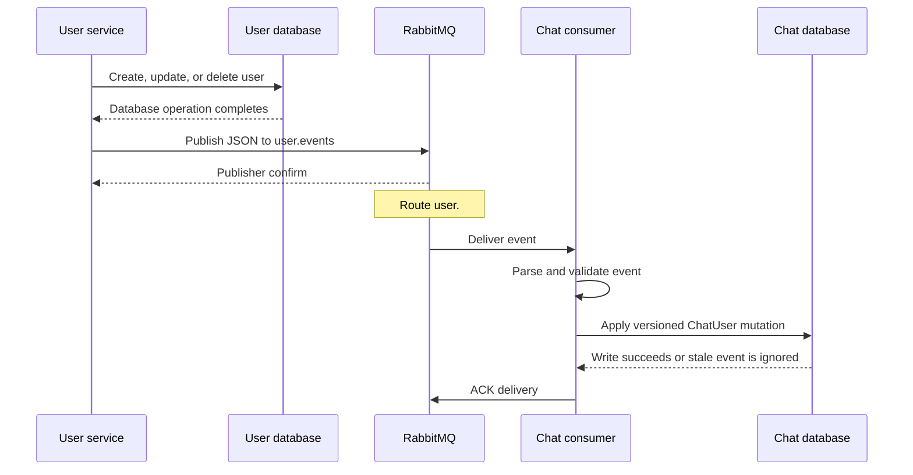

# RabbitMQ events and the ChatUser table

This describes the implementation as of November 3, 2026. The User service owns user accounts. The Chat service stores a small local copy in `ChatUser`, updated asynchronously through RabbitMQ. Chat queries can then join messages and group memberships to local profiles without calling the User service for every request.

## 1. The complete flow



The User service awaits publication, but it does not wait for Chat to update its database. There can be a delay between the two databases reflecting the same change. This is **eventual consistency**.

Publisher confirms acknowledge the broker's handling of publication. Consumer acknowledgements tell the broker that Chat has handled a delivery. These are independent mechanisms. See [RabbitMQ's acknowledgement documentation](https://www.rabbitmq.com/docs/confirms).

## 2. Where events originate

The [User-service publisher](../user-service/src/events/rabbitmq-events.service.ts) exposes three methods:

| Method | Event | Examples of current callers |
| --- | --- | --- |
| `publishCreated(user)` | `user.created` | Account creation in auth flows and superadmin user creation |
| `publishUpdated(user)` | `user.updated` | Account profile edits, avatar changes, superadmin profile edits, and an auth profile update path |
| `publishDeleted(userId)` | `user.deleted` | Account deletion and superadmin user deletion |

The callers are in [AuthService](../user-service/src/auth/auth.service.ts), [AccountsService](../user-service/src/accounts/accounts.service.ts), and [SuperadminService](../user-service/src/superadmin/superadmin.service.ts). They publish after the corresponding database mutation completes. These are explicit application calls: changing a database row manually does not automatically publish an event.

Both services declare the same RabbitMQ topology during startup:

| Setting | Current value |
| --- | --- |
| Exchange | `user.events`, type `topic`, durable |
| Queue | `chat.user-events`, durable |
| Binding | `user.#` |
| Published routing key | The event type, such as `user.updated` |
| Publisher options | Persistent messages, publisher confirms, 5-second publish timeout |
| Consumer options | Manual acknowledgement, `prefetch(1)` |

The exchange routes events; the queue holds deliveries for Chat. `prefetch(1)` limits each consumer to one unacknowledged delivery at a time. It does not create a global lock across multiple Chat instances.

Connection settings come from `RABBITMQ_HOST`, `RABBITMQ_PORT` (default `5672`), `RABBITMQ_DEFAULT_USER`, and `RABBITMQ_DEFAULT_PASS`. Both connections configure a 30-second broker heartbeat and a 2-second reconnect interval. This heartbeat monitors the broker connection; it does not track users being online.

## 3. What an event contains

Example profile event with synthetic values:

```json
{
  "eventId": "97886db3-3e4c-4338-b5a3-034355721ba4",
  "eventType": "user.updated",
  "version": "2026-11-03T10:00:00.000Z",
  "occurredAt": "2026-11-03T10:00:00.020Z",
  "data": {
    "userId": "8b65e578-9498-4275-a87c-efbd44afcc92",
    "username": "example-user",
    "displayName": "Example",
    "avatarUrl": null
  }
}
```

- `eventId` identifies the event. The publisher also uses it as the AMQP `messageId`. Chat currently does not store it for deduplication.
- `version` determines whether the incoming profile is newer. For creation and updates, it is the source user's `updatedAt` timestamp.
- `occurredAt` records when the publisher constructed the event.
- `data` contains the complete chat profile snapshot, rather than only changed fields.

For `user.deleted`, `data` contains only `userId`. The publisher uses the current time for both `version` and `occurredAt`.

The [consumer contract parser](src/events/user-event.ts) requires UUID v4 event/user IDs, parseable date strings, a supported event type, and the expected profile field types. Unknown event types are discarded even though the queue binding is broad enough to receive them.

## 4. How an event mutates ChatUser

[UserEventsConsumer.applyEvent](src/events/user-events.consumer.ts) changes these fields from the [Prisma schema](prisma/schema.prisma):

| ChatUser field | Created or updated event | Deleted event |
| --- | --- | --- |
| `id` | `data.userId` when inserting | `data.userId` when inserting |
| `username` | `data.username` | `null` |
| `displayName` | `data.displayName` | `null` |
| `avatarUrl` | `data.avatarUrl` | `null` |
| `sourceUpdatedAt` | `new Date(version)` | `new Date(version)` |
| `deletedAt` | `null` | `new Date(occurredAt)` |

Email, passwords, and the User service's global role are not copied. A group member's `ADMIN` or `MEMBER` role belongs to `GroupMember`, independently of this profile synchronization.

The write algorithm is:

1. Try `chatUser.updateMany` with both `id = event.data.userId` and `sourceUpdatedAt < event.version`.
2. If a row was updated, finish.
3. Otherwise, try `chatUser.createMany` with `skipDuplicates: true`.
4. If the ID already exists, the insert is skipped. If it is missing, a row is created.

That produces the following behavior when deliveries are processed sequentially:

| Existing local state | Incoming event | Result |
| --- | --- | --- |
| No row | Created or updated | Insert profile |
| Older version | Newer profile event | Replace profile and advance version |
| Same version | Duplicate delivery | Leave row unchanged |
| Newer version | Older event | Leave row unchanged |
| No row or older version | Deleted | Insert or update a deletion marker |

For example, after applying version `10:05`, a delayed event from `10:02` cannot overwrite it. Repeating version `10:05` also has no effect. This is how the current consumer handles retries without applying the same change again: it compares timestamps, rather than remembering `eventId` values.

An update can arrive before creation and still create the local profile. Likewise, a deletion can arrive first and create a **tombstone**: a retained row showing that the account was deleted. An older creation event cannot overwrite that tombstone.

## 5. Deletion preserves chat history

`user.deleted` does not call `chatUser.delete`. It clears profile fields and sets `deletedAt`, retaining the user's UUID. Messages, DM conversations, group memberships, reactions, and read states can continue referencing that row.

The consumer does not remove memberships, disconnect sockets, or revoke JWTs. Protected operations must separately enforce whether a user with `deletedAt != null` may act. Synchronizing a deletion and enforcing access are separate responsibilities.

Deletion is also not terminal in the current algorithm: a profile event with a strictly newer version clears `deletedAt` again. Equal timestamps are ignored, so if different events have the same version, the first applied state remains.

## 6. Acknowledgements and failures

The consumer starts through [EventsModule](src/events/events.module.ts), imported by [AppModule](src/app.module.ts). Its delivery handler behaves as follows:

| Outcome | Broker action |
| --- | --- |
| Malformed JSON | Log warning, ACK, discard |
| Invalid contract or unsupported event | Log warning, ACK, discard |
| Mutation succeeds, including ignoring an old event | ACK |
| Applying the event throws | `nack(message, false, true)` to requeue |

There is no application-level retry limit, delayed retry queue, or dead-letter queue configured here. A persistent database failure can therefore repeatedly requeue a delivery. The connection's 2-second reconnect interval is not a delay between failed database attempts.

If Chat commits the write and crashes before acknowledging it, RabbitMQ can redeliver the event. The timestamp comparison makes that sequential retry a no-op. See [RabbitMQ's reliability guide](https://www.rabbitmq.com/docs/reliability).

## 7. Where the HTTP fallback fits

[UserProfilesService.ensureActiveUsers](src/chat/user-profiles.service.ts) is currently called by [ChatService.createOrGetDm](src/chat/chat.service.ts).

It checks which requested users are absent from `ChatUser`, fetches only those missing profiles through `GET /accounts/:id` on `USER_SERVICE_URL`, and inserts them with duplicate skipping. Finally, it verifies that all requested local users have `deletedAt: null`.

This lets DM creation work when a creation event has not reached Chat yet, or when an account predates this consumer. A missing remote account produces `404`; an unavailable or invalid remote response produces `503`.

The public profile response has `createdAt`, but no `updatedAt`, so the fallback uses `createdAt` as `sourceUpdatedAt`. Later versioned events can replace that snapshot. The fallback only fills missing rows: it does not refresh existing profiles or discover a deletion whose event was missed.

## 8. Current consistency limits

The User database mutation and RabbitMQ publication are separate operations. There is no transactional outbox in this flow. If the process stops after committing the account change but before successfully publishing, Chat may never receive that change. Awaiting publisher confirmation does not close this database-to-broker gap.

On the consumer side, `updateMany` followed by `createMany` is two statements, with no explicit transaction or `SELECT FOR UPDATE`. The version condition protects updates to existing rows, but concurrent creation has a gap: two writers can both find no row, the older event can insert first, and the newer event's insert can then be skipped. Multiple consumers or the HTTP fallback can introduce that concurrency despite `prefetch(1)`.

These are limits of the current implementation, not features already solved by RabbitMQ. A local database lock also cannot eliminate the time before an event arrives from the User service.
