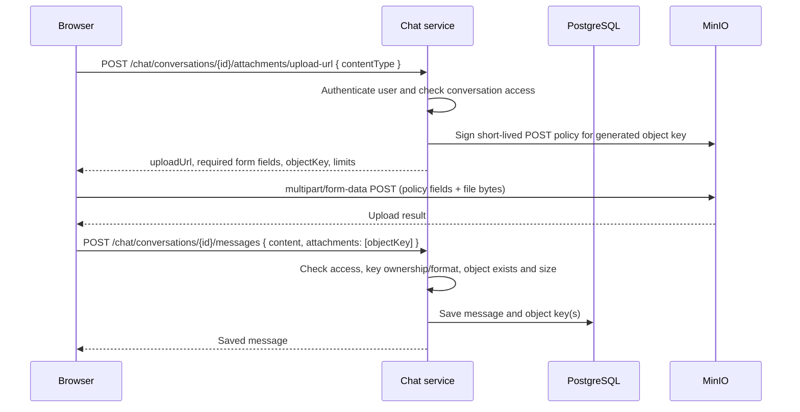

# Chat attachments: upload and download

This describes the implementation currently in the repo. The older [integration plan](minio-attachments-plan.md) is a proposal; some choices changed during implementation (for example, the current database field is `attachments String[]`, and uploads use a presigned POST policy).

## What goes where

- **MinIO** stores the actual file bytes in the private `chat-attachments` bucket.
- **PostgreSQL** stores each MinIO object key in `Message.attachments`. It does not store file bytes or presigned URLs.
- **The browser** sends file bytes directly to MinIO. The chat service only authorizes the operation, creates short-lived URLs, and checks the uploaded object before saving a message.

An object key looks like `attachments/<conversation-id>/<user-id>/<random-uuid>`. The server generates it; the original filename is not used as a storage path.

## Upload and send flow

In detail:

1. The tester asks Chat for a URL, supplying the file's MIME type. Chat authenticates the caller and checks that they can access the conversation. The DTO allows JPEG, PNG, WebP, GIF, and PDF.
2. `MinioService.createUploadUrl` generates a random UUID key scoped to that conversation and user. It signs a **POST policy** that expires in five minutes, requires the chosen content type, and limits the file to 1 byte through 10 MiB. The response contains the URL and form fields; the browser must send those fields and the file as `multipart/form-data`.
3. The browser uploads the bytes straight to MinIO. They do not pass through the chat API. This keeps large request bodies and bandwidth out of Chat.
4. The browser sends the message with the object key(s). Before writing the message, Chat verifies each key has the expected conversation/user prefix and UUID format, then asks MinIO for object metadata and checks its size. The message and keys are saved in PostgreSQL only after those checks pass.

The key is a reference, not proof of permission: all URL endpoints check authenticated conversation access. Message creation also verifies the key is in the current user's namespace and the object exists. The tester currently requires message text, supports up to five files, and keeps successfully uploaded keys locally so a retry does not upload those same selected files again.

## Viewing and downloading

Message history returns object keys. When an attachment is displayed, the browser requests a preview URL from:

`GET /chat/conversations/{conversationId}/attachments/preview-url?objectKey=...`

Chat checks conversation access and confirms that the key is attached to a non-deleted message in that conversation. It reads the object's metadata and creates a five-minute presigned GET URL with inline disposition only for JPEG, PNG, WebP, or GIF. The browser loads that URL as an image. Other types, including PDF, do not get an inline preview URL.

When the user chooses **Download**, the browser requests:

`GET /chat/conversations/{conversationId}/attachments/download-url?objectKey=...`

Chat performs the same access and message-reference checks, then returns a five-minute presigned GET URL with attachment disposition. The browser navigates to it; MinIO serves the file bytes. Since URLs are short-lived, the browser requests a fresh URL for a later preview or download.

## Why two MinIO clients and endpoints exist

Chat runs inside Compose and reaches MinIO at `MINIO_ENDPOINT=minio`, port `9000`. That is the internal service DNS name and is used for object checks and storage operations.

The browser cannot resolve the Compose hostname. A second client uses `MINIO_PUBLIC_ENDPOINT` (locally `localhost`) when signing URLs. Its host/port/SSL settings must describe the address the browser can actually reach. Keep MinIO credentials on the server; the browser receives only a time-limited signed URL and policy fields.

Because the browser posts directly to MinIO, MinIO CORS must allow the app's origin. Compose configures the local origins in `MINIO_API_CORS_ALLOW_ORIGIN`. CORS controls browser access; it does not replace Chat's authentication or authorization checks.

## Code map

- `src/minio/minio.config.ts` — internal and browser-facing connection settings.
- `src/minio/minio.module.ts` — creates the MinIO SDK clients.
- `src/minio/minio.service.ts` — presigned POST/GET generation, object metadata and size checks.
- `src/chat/chat.controller.ts` — authenticated upload URL, preview URL, and download URL routes.
- `src/chat/chat.service.ts` — conversation authorization, attachment-to-message checks, and message creation.
- `src/chat/dtos/create-attachment-upload-url.dto.ts` — accepted declared MIME types.
- `prisma/schema.prisma` — `Message.attachments String[]`.
- `auth-profile-web/src/pages/ChatPage.jsx` — browser upload, message send, preview, and download actions.
- `compose.yaml` and `envs/chat-service.env.example` — local MinIO networking and configuration names.

## Current limits to keep in mind

- The declared MIME type is constrained, but the current server does not inspect file signatures or scan for malware. Do not treat the browser's MIME type as proof of file contents.
- Upload URLs are bearer capabilities until they expire: anyone who obtains one can use it within its policy limits. Avoid logging or sharing them.
- A file uploaded successfully but never attached to a message can remain in the bucket. There is not currently an abandoned-upload cleanup job.
- Deleting a message does not currently remove its MinIO object. Cleanup needs an explicit retention/deletion policy.
- Download URLs are also bearer capabilities for five minutes; after URL issuance, MinIO serves the object without another Chat request.
