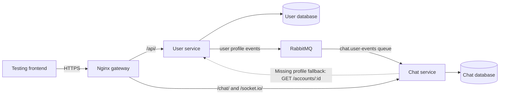
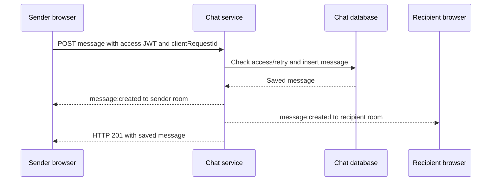

# Chat MVP: what we added and how it fits together

Source snapshot: 2026-11-01.

We now have a DM service connected to the existing User service, Docker stack, and testing frontend. Users can open a DM, send messages, load history, edit/delete their messages, and track unread messages. Socket.IO delivers newly created messages live. RabbitMQ updates Chat's local copy of user profiles.

This document explains the current code, including the unfinished parts. [API.md](API.md) and [openAPI.json](openapi.json) contain the endpoint reference; [MVP_PLAN.md](MVP_PLAN.md) tracks the roadmap. Some older planning/schema notes still describe intended behavior, so they should not be read as implementation guarantees.

## 1. What was already there, and what Chat adds

| Existing part | How the Chat additions use it |
| --- | --- |
| User service accounts, login, OAuth, and refresh sessions | Chat accepts the same access JWT. Users do not register or log in again with Chat. |
| User service PostgreSQL database | Remains the source of account identity. Chat has its own PostgreSQL database. |
| User service RabbitMQ publisher | Chat now listens to its existing profile events and maintains local `ChatUser` rows. |
| React account testing frontend | An authenticated `/chat-test` page reuses the existing profile, session, navigation, and user directory. |
| Nginx HTTPS gateway | New Chat REST and Socket.IO routes sit beside the existing `/api/` User-service routes. |
| Root Docker Compose stack | Adds `chat-service`, `chat-db`, their environment configuration, and startup dependencies. |
| Friends, blocks, and media storage | These still belong to their existing services. Chat does not yet enforce the social rules or support message attachments. |

User service owns identity and account data. Chat owns conversations, messages, read markers, and its future group memberships. `ChatUser.id` is the same UUID as the original user; there is no new Chat identity or foreign key across databases.



There are three communication paths: HTTP for operations and history, Socket.IO for live message delivery to browsers, and RabbitMQ for user-profile synchronization between services.

## 2. Authentication: reuse the existing session

The frontend signs in through User service and keeps the access token in its existing in-memory session store. Refreshing the session still goes through User service and its HttpOnly refresh cookie.

For Chat HTTP requests, the frontend sends `Authorization: Bearer <access-token>`. [AuthModule](../../chat-service/src/auth/auth.module.ts) verifies the signature with the User service's **public** RSA key and checks:

- Algorithm: `RS256`.
- Issuer: `user-service`.
- Audience: `ft-transcendence-api`.
- Expiration, a UUID `sub`, and the presence of an `exp` claim.

[AuthGuard](../../chat-service/src/auth/auth.guard.ts) puts the verified identity in `req.user.sub`. The controllers use that value for the current user. The `userId` in the create-DM body identifies the **other** user; message authorship comes from the verified token.

Socket connections pass the same token in `auth.token`. [ChatGateway](../../chat-service/src/chat/gateway/chat.gateway.ts) verifies it before accepting the connection. Literal `\n` sequences in the configured public key are converted into real newlines so the PEM loads correctly.

The frontend [Chat client](../auth-profile-web/src/lib/chat.js) retries an HTTP request once after a `401`, using the existing session-refresh API. Session changes also reconnect the Chat socket. Chat stores no password or refresh token and needs no private signing key.

## 3. Database and Prisma

[schema.prisma](../../chat-service/prisma/schema.prisma) defines the Chat data. [PrismaService](../../chat-service/src/prisma/prisma.service.ts) connects using the PostgreSQL driver adapter; [prisma.config.ts](../../chat-service/prisma.config.ts) supplies the same connection settings to Prisma commands.

| Model | Purpose and current use |
| --- | --- |
| `ChatUser` | Local public-profile copy: original UUID, username, display name, avatar URL, source version timestamp, and deletion marker. No email, password, or account role is copied. |
| `Conversation` | Common destination for messages. A DM stores the two participant IDs; the schema also supports a group channel. |
| `Message` | UUID, conversation, author, content, timestamps, request identity/hash, and a mutation version. |
| `ConversationReadState` | One row per `(conversationId, userId)` recording `lastReadMessageId`. |
| `Group` and `GroupMember` | Tables for later group/channel work, including group-specific `ADMIN` and `MEMBER` roles. |
| `Reaction` | Schema for later emoji reactions; there are no reaction endpoints yet. |

A DM's two IDs are lowercased and sorted before lookup/insertion. The unique pair `(dmUserAId, dmUserBId)` gives A-to-B and B-to-A the same identity. `kind` is explicitly set to `DM` by the create-DM service method. Planned channels use `kind: CHANNEL` and a `groupId` instead.

Messages use UUIDs. History and unread comparisons use `(createdAt, id)` so equal creation timestamps have a consistent tie-breaker. This is not an auto-incrementing sequence or a guaranteed database commit order.

Two migrations are present: [initial tables](../../chat-service/prisma/migrations/20261031040933_init/migration.sql) and [read state](../../chat-service/prisma/migrations/20261031063521_last_read/migration.sql). The initial migration includes the unique DM pair and `(authorId, clientRequestId)` indexes. Extra checks in [constraints.sql](prisma/constraints.sql), such as enforcing valid DM/channel shapes, are **not included in those migration files**. `prisma migrate deploy` does not automatically execute that separate file.

## 4. DM and message operations

All seven routes below are protected by `AuthGuard`. They are implemented in [ChatController](../../chat-service/src/chat/chat.controller.ts) and [ChatService](../../chat-service/src/chat/chat.service.ts).

| Method and route | Input | Current result |
| --- | --- | --- |
| `POST /chat/conversations/dm` | Body: `userId` | `201`, existing or newly created DM. |
| `GET /chat/conversations` | None | `200`, caller's DM conversations with `lastReadMessageId` and `unreadCount`. |
| `POST /chat/conversations/:conversationId/messages` | Body: `content`, `clientRequestId` | `201`, new message or stored result of an identical retry. |
| `GET /chat/conversations/:conversationId/messages` | Query: optional `limit`, `before` | `200`, a message array, newest first. |
| `PATCH /chat/conversations/:conversationId/read-state` | Body: `messageId` | `200`, empty body after saving the marker. |
| `PATCH /chat/messages/:messageId` | Body: `content` | `200`, edited message. |
| `DELETE /chat/messages/:messageId` | None | `204`, soft deletion. |

DTOs live in [src/chat/dtos](../../chat-service/src/chat/dtos). The global validation pipe rejects unknown body/query properties and applies DTO transformations. New and edited message text is trimmed and must contain 1–2000 characters.

### Opening a DM

1. Read the current user from `req.user.sub` and the target from the DTO.
2. Normalize and sort both UUIDs.
3. Ensure both local user profiles exist and are not marked deleted, using the HTTP fallback only for missing rows.
4. Look up the unique participant pair.
5. Return the existing conversation, or create and return a new `DM`.

The database prevents duplicate pairs. The current read-then-create implementation still needs unique-conflict handling so two simultaneous first requests both receive the existing conversation cleanly. Self-DM rejection currently throws a generic error rather than a controlled `400` response, and the comparison occurs before UUID normalization.

### Sending and retrying a message

The browser creates a `clientRequestId` once for a logical send. Chat checks DM membership, then hashes the validated original payload on the server:

```text
requestHash = SHA-256(JSON.stringify([conversationId, content]))
retry identity = (authorId, clientRequestId)
```

| Request | What happens |
| --- | --- |
| First request with that retry identity | Save the message and broadcast `message:created`. |
| Same identity and same original payload | Return the stored message; do not insert or broadcast again. |
| Same identity with different content or conversation | Return `409 Conflict`. |

This is the idempotency logic we added: retrying after a lost response should not create another message. Sending the same text intentionally with a **new** request ID creates a new message normally. The browser sends no `requestHash`; the server computes it. The hash remains unchanged after edits/deletion so retries still refer to the original send.

Concurrent first sends with the same request ID are constrained by the database, but converting the losing unique-constraint error into the stored result remains unfinished.

### Editing and deleting

The update filters require the caller to be the author and the message to be undeleted. Edits replace content, set `editedAt`, and increment `version`. Deletion clears content, sets `deletedAt`, and increments `version`, retaining the message row and ID. History can therefore show a deleted-message placeholder, and a read marker can still refer to that row.

Only message creation currently broadcasts a socket event. Editing/deleting from another client does not yet update the open tester automatically.

## 5. History, read state, and unread counts

### Loading history

`getMessages` checks access, orders by `createdAt DESC, id DESC`, and optionally uses `before` as a Prisma cursor with `skip: 1`. `before` is a message UUID supplied in the request; it is not another table column. The DTO defaults `limit` to 50 and permits 1–100.

The current response is a raw array of up to **`limit + 1`** messages. There is no `items/hasMore/nextCursor` envelope or removal of the extra look-ahead row yet. The cursor's conversation is also not explicitly validated. These details matter when adding the older-history UI.

The tester requests `limit=50`, reverses the returned array for chronological display, and currently has no load-older button. It can therefore display up to 51 rows from that request.

### Recording a read marker

The read-state endpoint verifies that the message belongs to the conversation and the caller is a DM participant. It then upserts the caller's `ConversationReadState` row using the conversation/user composite key.

[ChatPage.jsx](../auth-profile-web/src/pages/ChatPage.jsx) now calls it when a selected conversation has loaded messages and `document.visibilityState` is `visible`. It sends the newest loaded message's ID, including after live arrivals and when returning to a hidden tab. It avoids repeating the same marker during the page lifetime and checks that the message belongs to the selected conversation.

After a successful PATCH, the page sets that conversation's local unread badge to zero. This is a basic tester rule: it treats the latest loaded message in a visible tab as read. It does not track scroll position, actual viewport exposure, or window focus.

### Calculating unread messages

`GET /chat/conversations` calculates the count from saved messages for each conversation:

```text
unread = messages authored by someone else
         AND not soft-deleted
         AND after the read marker in (createdAt, id) order
```

Without a marker, all non-deleted messages from the other participant count as unread. The response includes the marker and count, so the frontend needs no separate unread-count endpoint or stored counter.

The backend currently permits moving a marker backward. Overlapping PATCH requests can arrive out of order, and a concurrent conversation-list response can overwrite the frontend's local badge update. Monotonic marker updates and coordinated refreshes are still needed. There is also no socket read-receipt event or offline push-notification system yet.

## 6. Broadcasting through Socket.IO

We added Nest's Socket.IO driver and the frontend `socket.io-client` dependency. On connection, Chat verifies the token, records the UUID in `socket.data.userId`, and joins the socket to `user:<userId>`. Clients do not choose someone else's room.

After saving a new message, `ChatService` asks `ChatGateway` to emit `message:created` to the rooms of **both** DM participants. This updates the recipient and any other tabs/devices belonging to the sender. The event contains the saved Message object.



The HTTP response and socket event may reach the browser in either order. The tester merges messages using message/request IDs to avoid displaying its own send twice.

The namespace is `/chat`; the Socket.IO transport path is `/socket.io`. These are separate settings. REST remains the message-write path, and there are no client-to-server application message events.

Delivery is currently best effort on one Chat instance. There is no durable message-event outbox or shared socket adapter. Reconnecting the transport does not replay missed events, and the current frontend `connect` handler only changes the connection label. Automatic history reload on reconnect remains to be added. An already-connected socket is also not disconnected when its token expires.

## 7. RabbitMQ profile synchronization

The [existing User-service publisher](../../user-service/src/events/rabbitmq-events.service.ts) sends public-profile events after account mutations. Chat's new [EventsModule](../../chat-service/src/events/events.module.ts), registered in [AppModule](../../chat-service/src/app.module.ts), starts [UserEventsConsumer](../../chat-service/src/events/user-events.consumer.ts).

| Contract | Value |
| --- | --- |
| Exchange | `user.events`, durable topic exchange |
| Queue | `chat.user-events`, durable |
| Binding | `user.#` |
| Routing key | The event's `eventType` |
| Event types handled | `user.created`, `user.updated`, `user.deleted` |
| Envelope | `eventId`, `eventType`, `version`, `occurredAt`, `data` |
| Profile data | `userId`, `username`, `displayName`, `avatarUrl` |
| Deletion data | `userId` |

For profile events, `version` is the User-service row's `updatedAt` timestamp. For deletion, the publisher uses the deletion event timestamp. This event version is a date string; the Message model's `version` is a separate integer used for message mutations.

The consumer:

1. Parses JSON and validates the payload with [parseUserEvent](../../chat-service/src/events/user-event.ts).
2. Updates an existing `ChatUser` only when its `sourceUpdatedAt` is older than the event version.
3. If no row was updated, attempts an insert with duplicate IDs skipped. An ordinary duplicate or older delivery therefore leaves an existing newer row alone.
4. For deletion, clears the copied profile fields and records `deletedAt`, keeping the UUID as a tombstone.
5. Acknowledges a valid event after database work succeeds. Processing failures are negatively acknowledged and requeued.

Malformed/unsupported payloads are logged generically and acknowledged/discarded. They are not saved to a dead-letter queue. Prefetch is 1 per consumer; the connection manager uses a 30-second broker heartbeat and reconnects after connection failure. This heartbeat monitors the broker connection, not user activity.

This supplies asynchronous profile synchronization without making each Chat request fetch account data. It does not deliver chat messages to browsers or synchronize friendships, blocks, roles, or logout sessions.

Current boundaries to keep in mind:

- The User-service database commit and publication are separate. A crash between them can still lose an event; no reconciliation job repairs missed updates/deletions yet.
- Retries are unbounded and immediate; permanent processing failures can keep requeueing. There is no backoff/dead-letter policy.
- Update and insert are separate statements. Concurrent first events, or an HTTP bootstrap racing the consumer, still need an atomic version-aware upsert. Equal timestamp conflicts are also unresolved.
- Deletion is protected from older profile events by timestamp comparison, but it is **not terminal by rule**: a newer profile event can clear `deletedAt`. Deleted accounts are checked when opening a DM, but existing message operations and sockets do not yet consistently enforce deletion or disconnect the user.

## 8. `UserProfilesService` is the HTTP fallback

[UserProfilesService](../../chat-service/src/chat/user-profiles.service.ts) lives inside Chat. It fills missing local users when `createOrGetDm` calls `ensureActiveUsers`.

It looks up both UUIDs locally, requests `GET /accounts/:id` from `USER_SERVICE_URL` only for missing rows, validates the public response, inserts the copied fields with duplicates skipped, and finally verifies both local users have `deletedAt: null`.

The HTTP request has a three-second timeout. A missing source user becomes `404`; unavailable or invalid source responses become `503`. Existing deletion tombstones are not fetched again or overwritten by this fallback.

The public endpoint exposes `createdAt` but not `updatedAt`. The fallback uses `createdAt` as a lower bound for `sourceUpdatedAt` so subsequent versioned events can replace the snapshot. It cannot determine the snapshot's exact version, so an older queued update can temporarily overwrite a newer HTTP snapshot.

This covers older accounts and missed creation events. It does not refresh an already-present user, run periodically, or repair missed updates/deletions. Also, the current conversations API/UI still uses participant IDs; synchronizing names does not yet produce profile cards or live name updates in the tester.

## 9. Docker, Nginx, and local configuration

[Root Compose](../../compose.yaml) now starts a dedicated PostgreSQL 18 `chat-db` with data under `volumes/chat-db`, plus the Nest `chat-service` container. Chat waits for healthy PostgreSQL/RabbitMQ and for User service to start. The database is internal to Docker; root Compose publishes no Chat database port to the host.

[Dockerfile](../../chat-service/Dockerfile) installs dependencies, generates the Prisma client, and builds Nest. Container startup runs `prisma migrate deploy` before `node dist/main.js`, as the `node` user. Chat's HTTP healthcheck requests `/`; it does not prove the broker consumer is ready or synchronization is complete.

| Configuration | Purpose |
| --- | --- |
| [envs/chat-db.env.example](../../envs/chat-db.env.example) | Template for the dedicated database credentials. |
| [envs/chat-service.env.example](../../envs/chat-service.env.example) | Template for Chat's database, HTTP fallback, public JWT key, and port settings. |
| Shared `envs/rabbitmq.env` | Supplies broker credentials to RabbitMQ and both backend services; Compose sets the internal host and port. |
| `POSTGRES_*` | Chat's own database connection; the database and service credentials must agree. |
| `JWT_PUBLIC_KEY` | Public verification key corresponding to User service's signing key. |
| `USER_SERVICE_URL` | Internal fallback URL, normally `http://user-service:3000` in Compose. |
| `RABBITMQ_*` | `HOST`, `PORT`, `DEFAULT_USER`, and `DEFAULT_PASS` required by the consumer. |
| `VITE_API_URL=/api`, `VITE_CHAT_URL=/` | Browser requests go through the same HTTPS gateway. These frontend variables contain no secrets. |

[Nginx](../../nginx/default.conf) routes requests as follows:

| Browser path | Destination |
| --- | --- |
| `/api/*` | User service, with `/api/` stripped. |
| `/chat/*` | Chat REST, preserving the path. |
| `/socket.io/*` | Chat Socket.IO transport, with upgrade support and buffering disabled. |
| `/chat-test` and other frontend paths | Testing frontend. |

The frontend's [Vite proxy](../auth-profile-web/vite.config.js) also supports standalone development. Its `^/chat/` rule deliberately leaves `/chat-test` available as a frontend route. The shared navigation helper now allows `/chat-test`, fixing the Chat button's earlier redirect back to Account.

In Docker, services can each listen on their own port 3000. For standalone processes on the host, use distinct ports and a separate development database if needed. RabbitMQ now exposes AMQP on `127.0.0.1:5672`; Docker uses hostname `rabbitmq`, while host processes use `localhost`.

**A separate Chat database needs a separate event queue.** Both the current Compose and standalone consumers use the hardcoded `chat.user-events` queue. Running both against different databases makes them compete for events: each delivery goes to one consumer. For independent environments, give each a separately bound queue or run only the intended consumer. Multiple consumers sharing one database are a different case, but the concurrency limitations above still apply.

The frontend container runs the Vite development server from copied source. It has no source bind mount, so local frontend edits require an image rebuild to appear in that container.

## 10. How to try the combined flow

With the environment files and local HTTPS certificate already configured, run from the repository root:

```powershell
docker compose up -d --build
docker compose ps
```

1. Open `https://localhost`, sign in, and click **Chat**, or visit `/chat-test` directly.
2. Copy another user's UUID from **People here** and open the DM.
3. Select it to load history; the visible tab records the latest loaded message as read.
4. Send a message. The server saves it, broadcasts to both users, and returns it over HTTP.
5. Use a different browser profile/private session for the other account to test recipient delivery. Keep that conversation closed or its tab hidden to observe unread counts, then open it to record the read marker.
6. Change a test account's public profile through the existing User-service UI/API. Inspect its local `ChatUser` row to verify RabbitMQ synchronization; the tester currently displays participant UUIDs.

Useful read-only checks from the repository root:

```powershell
docker compose logs --tail 50 chat-service
docker compose exec -T rabbitmq rabbitmqctl list_queues name messages_ready messages_unacknowledged consumers
```

An empty queue and an attached consumer demonstrate connectivity, not that every historic profile is synchronized. The previous implementation session recorded a connected consumer, an empty queue, automatic reconnection after broker restart, and a sender-room message smoke test. Those observations are historical; this document update does not rerun the stack.

## 11. File map and verification

| Area | Where to read |
| --- | --- |
| Startup and module registration | [main.ts](../../chat-service/src/main.ts), [app.module.ts](../../chat-service/src/app.module.ts) |
| JWT verification and request identity | [auth.module.ts](../../chat-service/src/auth/auth.module.ts), [auth.guard.ts](../../chat-service/src/auth/auth.guard.ts) |
| Routes, DTOs, and business logic | [chat.controller.ts](../../chat-service/src/chat/chat.controller.ts), [dtos](../../chat-service/src/chat/dtos), [chat.service.ts](../../chat-service/src/chat/chat.service.ts) |
| Socket authentication, rooms, broadcasts | [chat.gateway.ts](../../chat-service/src/chat/gateway/chat.gateway.ts) |
| RabbitMQ lifecycle and profile updates | [user-events.consumer.ts](../../chat-service/src/events/user-events.consumer.ts), [user-event.ts](../../chat-service/src/events/user-event.ts) |
| Missing-profile HTTP fallback | [user-profiles.service.ts](../../chat-service/src/chat/user-profiles.service.ts) |
| Tables and database connection | [schema.prisma](../../chat-service/prisma/schema.prisma), [prisma.service.ts](../../chat-service/src/prisma/prisma.service.ts), [prisma.config.ts](../../chat-service/prisma.config.ts) |
| Browser Chat behavior | [ChatPage.jsx](../auth-profile-web/src/pages/ChatPage.jsx), [chat.js](../auth-profile-web/src/lib/chat.js) |
| Existing frontend session integration | [AuthProvider.jsx](../auth-profile-web/src/auth/AuthProvider.jsx), [runtime.js](../auth-profile-web/src/lib/runtime.js), [session.js](../auth-profile-web/src/lib/session.js) |
| Frontend navigation and layout | [App.jsx](../auth-profile-web/src/App.jsx), [navigation.js](../auth-profile-web/src/lib/navigation.js), [styles.css](../auth-profile-web/src/styles.css) |
| Containers and gateway | [compose.yaml](../../compose.yaml), [Dockerfile](../../chat-service/Dockerfile), [default.conf](../../nginx/default.conf) |
| API reference and next features | [API.md](API.md), [openAPI.json](openapi.json), [MVP_PLAN.md](MVP_PLAN.md) |

The current Chat unit suite contains three [consumer tests](src/events/user-events.consumer.spec.ts) covering basic contract rejection and mocked update/insert paths, plus one [root-controller test](../../chat-service/src/app.controller.spec.ts). The frontend has a [Chat navigation regression test](../auth-profile-web/test/navigation.test.mjs). These do not establish end-to-end correctness for concurrent retries, deletion handling, recipient isolation, or read-state races.

Commands from the Chat directory are `npm run build`, `npm run lint`, and `npm test`. Frontend compilation uses `npm run build` from `auth-profile-web`. The earlier session recorded successful Chat build/lint and four tests. These are previous results, not checks newly run for this documentation change.

## 12. Where we go next

The main additions are in place, with a working path through the existing authentication, gateway, and test interface. Before treating the MVP as complete, the remaining work is:

- Verify delivery to both participants and isolation from unrelated users; reload missed history on reconnect and handle socket token expiry.
- Finish the pagination response/UI and make read markers advance monotonically.
- Handle concurrent first DM creation and message retries cleanly.
- Enforce deleted-account and block eligibility consistently; add profile reconciliation, safer event retries, and atomic profile updates.
- Bring the intended database shape checks into migrations.
- Build group/channel endpoints and permissions on the existing schema; add edit/delete broadcasts and reactions when needed.
- Add activity/presence later. RabbitMQ heartbeat and a connected socket alone do not implement idle status, last seen, or offline notifications.

The detailed behavior and next feature decisions remain in [MVP_PLAN.md](MVP_PLAN.md).
