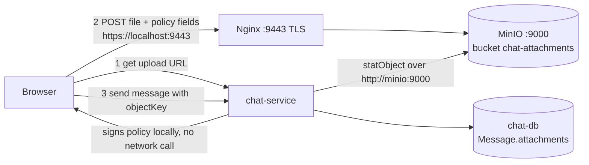
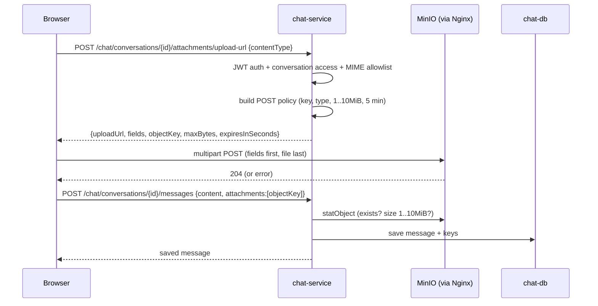

# MinIO and presigned URLs in Nook: the complete guide

One-sitting read, same format as [RABBITMQ.md](RABBITMQ.md). It covers the concepts, the exact flow in this project, the code, the infrastructure, a hands-on lab and evaluation Q&A. Written from the code as of November 2026.

Sources consolidated here: [MINIO_ATTACHMENTS.md](../chat-service/MINIO_ATTACHMENTS.md) (the implementation doc), [minio-attachments-plan.md](../chat-service/minio-attachments-plan.md) (the original proposal, partly superseded), [minio.md](minio.md), `compose.yaml`, `nginx/default.conf`, `minio-init/init.sh`, and the `chat-service/src/minio/*` and `chat.service.ts` code.

---

## 1. The problem

Users attach images and PDFs to chat messages. Where do the bytes go?

| Option | Problem |
| --- | --- |
| Store files in PostgreSQL | Bloats the DB, slow backups, bad for large binaries |
| Upload through chat-service, which writes to disk or S3 | Every byte passes through the API. It ties up Node memory and bandwidth, and one 10 MB upload occupies a request for seconds |
| **Browser uploads straight to object storage using a short-lived signed permission** | Chosen. The API only issues the permission and verifies the result |

That signed permission is a **presigned URL** (or, for uploads here, a **presigned POST policy**).

## 2. Primer

**Object storage (S3 model).** Files ("objects") live in **buckets**. Each object is addressed by a **key**, a string that looks like a path (`attachments/abc/def/uuid`) but is really a flat name. **MinIO** is a self-hosted server that speaks the Amazon S3 API.

**Presigned URL.** The server holds the secret key. It computes a **signature** (HMAC over the method, bucket, key, expiry and some headers) and appends it to the URL as query parameters. Anyone holding that URL can perform exactly that one operation until it expires, without having any credentials. MinIO recomputes the signature and compares.

Consequences worth remembering:

- The URL is a **bearer capability**: possession equals permission. Treat it like a short-lived password. Do not log it.
- The signature covers the **host** the URL was signed for. If the request arrives with a different `Host` header, verification fails (`SignatureDoesNotMatch`). This is the single most common source of presigned URL bugs and explains the two-client design in section 5.
- Nothing is looked up in a database at use time. Validity is purely the signature plus the expiry.

**Presigned GET vs presigned POST policy.**

| | Presigned GET (download/preview) | Presigned POST policy (upload) |
| --- | --- | --- |
| HTTP | `GET url` | `POST` of `multipart/form-data` to a URL |
| Carries | everything in the query string | a set of **form fields** (policy + signature) plus the file |
| Constraints | expiry, key, response headers | expiry, exact key, exact content type, **file size range**, bucket |

Why POST policy for uploads and not a presigned PUT? A presigned PUT cannot limit the file size. A POST policy can enforce `content-length-range` on the storage side, so a malicious client cannot upload 5 GB. (The original plan proposed presigned PUT; the implementation changed to POST for this reason.)

**CORS.** The page at `https://localhost` POSTs to `https://localhost:9443`, a different origin, so the browser requires MinIO to answer with CORS headers permitting the app's origin. CORS is a browser rule, not security for the API. It does not replace authorization.

## 3. Architecture at a glance



What is stored where:

- **MinIO:** the bytes, in the private bucket `chat-attachments`.
- **PostgreSQL:** only the object **keys**, in `Message.attachments String[]`. Never bytes, never URLs (they expire).
- **Browser:** receives short-lived URLs and fields, never the MinIO credentials.

Object key format: `attachments/<conversationId>/<userId>/<random uuid v4>`. The server generates it; the user's filename is never part of the key.

## 4. The three flows

### 4.1 Upload and send



Step by step:

1. **Request.** The client sends only the MIME type. The DTO (`create-attachment-upload-url.dto.ts`) allows JPEG, PNG, WebP, GIF and PDF.
2. **Sign.** `MinioService.createUploadUrl` builds the key, then a policy: bucket, exact key, exact content type, size 1 byte to 10 MiB, expires in 5 minutes. `presignedPostPolicy` returns `{postURL, formData}`. This is a **local computation**: no request to MinIO is made to produce it.
3. **Upload.** The browser sends the form fields followed by the file as `multipart/form-data` straight to MinIO. If the file is too large, the wrong type, or late, MinIO itself rejects it.
4. **Send.** The message request carries the key(s). `chat.service.ts` calls `verifyUploadedAttachment` for each one **before** saving.

### 4.2 Verification at send time (the real security check)

`verifyUploadedAttachment(objectKey, conversationId, userId)`:

1. Requires the key to start with `attachments/<this conversation>/<this user>/`. So a user cannot attach somebody else's upload, or an upload from another conversation.
2. The remainder must be a valid UUID v4. This blocks path tricks such as `../` or other prefixes.
3. `statObject` against MinIO (over the internal endpoint) must succeed, meaning the object really exists. Size must be between 1 byte and 10 MiB.

Only then is the message written. Why check at all if the policy already limited the upload? Because the client could simply send a key it never uploaded, or a key belonging to someone else. The key is a *reference*, never proof of anything.

The idempotency hash for message retries also covers the attachment list (`JSON.stringify([conversationId, content, attachments])`), so retrying the same request ID with a different attachment set conflicts.

### 4.3 Preview and download

Message history returns keys. To show or fetch a file the client asks chat-service:

- `GET /chat/conversations/{id}/attachments/preview-url?objectKey=...`
- `GET /chat/conversations/{id}/attachments/download-url?objectKey=...`

Both go through `assertAttachmentAccessible`: authenticated user, member of the conversation, key starts with `attachments/` and is at most 200 characters, **and a non-deleted message in that conversation actually references this key** (`attachments: { has: objectKey }`). Then:

- **Download:** presigned GET, 5 minutes, `response-content-disposition=attachment` so the browser saves rather than renders it.
- **Preview:** reads the object's real content type via `statObject`. Only JPEG, PNG, WebP and GIF get an inline URL (`response-content-disposition=inline`). PDFs and anything else return no preview. This is a deliberate safety choice, since rendering arbitrary content types inline is how stored XSS happens.

After the URL is issued, MinIO serves the bytes directly. Chat is out of the loop, which is why the lifetime is only 5 minutes.

## 5. The two-client, two-endpoint design

This is the part that confuses people. `MinioModule` creates **two** MinIO SDK clients:

| Injection token | Endpoint (local) | Used for |
| --- | --- | --- |
| `MINIO_CLIENT` | `minio:9000`, HTTP (internal) | `statObject`, `bucketExists`, `makeBucket`, `removeObject`: server-to-server calls inside Docker |
| `MINIO_PRESIGN_CLIENT` | `localhost:9443`, HTTPS (public) | **only** signing presigned GET/POST URLs |

Why? The signature includes the host. The browser can reach MinIO only at `https://localhost:9443` (the `minio` hostname does not exist outside Docker, and port 9000 is not published). So URLs must be signed *as if for* `localhost:9443`. But chat-service itself, inside Docker, must reach MinIO at `minio:9000`. Same credentials, different address.

The path of a browser request:

```
browser --HTTPS--> Nginx :9443 (TLS with the local cert)
                   proxy_set_header Host $http_host   <- keeps "localhost:9443", so the signature matches
                   --HTTP--> minio:9000
```

Key lines in `nginx/default.conf` (server block `listen 9443 ssl`):

- `client_max_body_size 12m` covers the 10 MiB file limit plus multipart overhead.
- `proxy_buffering off` and `proxy_request_buffering off` stream the upload instead of buffering it.
- `proxy_set_header Host $http_host` is **the** critical line. Without it, signatures fail.
- `proxy_pass http://minio_s3` with `upstream minio_s3 { server minio:9000 resolve; }`.

CORS: set on the MinIO server through `MINIO_API_CORS_ALLOW_ORIGIN` in `envs/minio.env` (currently `https://localhost`). Never `*` for a private deployment.

## 6. Code map (read in this order)

| File | What to look for |
| --- | --- |
| `chat-service/src/minio/minio.constants.ts` | The two injection tokens |
| `chat-service/src/minio/minio.config.ts` | Validated env readers; `minioClientOptions` (internal) vs `minioPresignClientOptions` (public); region default `us-east-1` |
| `chat-service/src/minio/minio.module.ts` | Builds both `Client`s |
| `chat-service/src/minio/minio.service.ts` | Constants (5 min TTL, 10 MiB max, inline image set); `createUploadUrl`, `createDownloadUrl`, `createInlineImageUrl`, `verifyUploadedAttachment`; `onModuleInit` ensures the bucket exists but only **logs** on failure, so chat still works without attachments |
| `chat-service/src/chat/chat.controller.ts` | Routes `.../attachments/upload-url`, `download-url`, `preview-url` (all behind the auth guard) |
| `chat-service/src/chat/chat.service.ts` | `createAttachment*Url`, `assertAttachmentAccessible`, and the verification loop inside `sendMessage` |
| `chat-service/src/chat/dtos/create-attachment-upload-url.dto.ts` | MIME allowlist |
| `chat-service/prisma/migrations/20261106120000_message_attachments` | The `attachments` array column |
| `client/lib/chat/client.ts` | The browser side. XHR upload with progress, then message send |
| `client/components/app/chat/message-list.tsx` | Requests preview URLs when rendering |

## 7. Infrastructure and provisioning

**`compose.yaml`**

- `minio`: built from `./minio` (see caveat below), command `server /data --console-address :9001`, env from `envs/minio.env`, console published on `127.0.0.1:9001` only, data in `./volumes/minio`, healthcheck on `/minio/health/live`. The S3 port 9000 is **not** published.
- `minio-init`: a one-shot container (`restart: "no"`) that runs after MinIO is healthy. `chat-service` has `depends_on: minio-init: condition: service_completed_successfully`, so the bucket and credentials always exist before chat starts.
- `nginx`: `depends_on` includes `minio` and exposes 9443.

**`minio-init/init.sh`** (idempotent, safe on every `up`):

1. Connects as the **root** user with the `mc` client.
2. `mc mb --ignore-existing local/$MINIO_BUCKET` creates the private bucket.
3. Writes a policy `chat-attachments-rw` allowing only `ListBucket`/`GetBucketLocation` on the bucket and `GetObject`/`PutObject`/`DeleteObject` on `bucket/*`.
4. Creates (or resets the secret of) a **service user** whose keys equal `MINIO_ACCESS_KEY/MINIO_SECRET_KEY` from `chat-service.env`, and attaches the policy.

This is **least privilege**: chat-service never has the root credentials. If the chat credentials leaked, the attacker could touch only this one bucket. The root credentials live only in `envs/minio.env`, which chat-service does not load. (This is also why `onModuleInit` cannot create buckets with its scoped user and just logs.)

**Env files**

- `envs/minio.env`: `MINIO_ROOT_USER`, `MINIO_ROOT_PASSWORD`, `MINIO_API_CORS_ALLOW_ORIGIN`.
- `envs/chat-service.env`: `MINIO_ENDPOINT=minio`, `MINIO_PORT=9000`, `MINIO_USE_SSL=false`, `MINIO_REGION=us-east-1`, `MINIO_BUCKET=chat-attachments`, `MINIO_ACCESS_KEY/SECRET_KEY` (scoped), `MINIO_PUBLIC_ENDPOINT=localhost`, `MINIO_PUBLIC_PORT=9443`, `MINIO_PUBLIC_USE_SSL=true`.

**Caveat from `docs/infra/minio.md`:** the upstream MinIO community repository is archived. The `minio/Dockerfile` builds a pinned upstream commit from source because the official images were unavailable. Fine for the project; be ready to say it should be reassessed for production (for example, moving to a maintained S3-compatible server or a managed S3).

**Monitoring:** `infra/monitoring` also tracks MinIO; see [monitoring.md](monitoring.md).

## 8. Security properties and known limits

What holds up:

| Property | How |
| --- | --- |
| No credentials in the browser | Only signed URLs/fields are returned |
| Only members can get URLs | Auth plus conversation membership on every URL endpoint |
| Cannot attach another user's/conversation's object | Key prefix check at send time |
| Cannot download an object not in the conversation | Message-reference lookup in `assertAttachmentAccessible` |
| Size and type bounded at the storage layer | POST policy `content-length-range` and exact content type |
| Short exposure | 5-minute expiry on every URL |
| No filename in the path | Server-generated UUID key |
| Safe rendering | Inline only for 4 image types; everything else is `attachment` |

Known limits (say these before the evaluator does):

1. **MIME is declared, not inspected.** No magic-byte check, no antivirus. The browser's claim and the policy match, but the content is not verified. Mitigated partly by the strict inline-image-only preview.
2. **URLs are bearer tokens.** Anyone who obtains one can use it until expiry. Do not log them.
3. **Orphans.** A file uploaded but never attached stays in the bucket. There is no cleanup job. Fix: a scheduled sweep of old keys not referenced by any message, or an S3 lifecycle rule on a staging prefix.
4. **Deleting a message does not delete the object.** `MinioService.removeObject` exists but is not called from message deletion. Fix: delete on message removal, or an outbox/cleanup job (MinIO and Postgres cannot share a transaction).
5. **`onModuleInit` swallows bucket errors.** Chat boots without attachments if the bucket is missing; the error appears only in logs.
6. **Documentation drift.** The plan doc proposed a `MessageAttachment` table with originalName and size; the implementation uses `attachments String[]`, so there is no stored filename, size or content type, and the preview endpoint recovers the type from `statObject`. `MINIO_ATTACHMENTS.md` mentions `auth-profile-web/.../ChatPage.jsx`; the real browser code is now under `client/`.

## 9. Hands-on lab (20 minutes)

Prereqs: stack running (`docker compose up -d --build`).

1. **See the storage.** Open the MinIO console at `http://localhost:9001`, log in with the root creds from `envs/minio.env`. Find the bucket `chat-attachments`. Under Identity, find the service user and its `chat-attachments-rw` policy.
2. **Upload an image in chat** and refresh the console. Find the object at `attachments/<convId>/<userId>/<uuid>`. Note: no extension, no filename.
3. **Inspect the DB.** In chat-db: `SELECT id, attachments FROM "Message" WHERE cardinality(attachments) > 0;` (confirm the table and column names against the Prisma mapping first). You will see keys only.
4. **Read a presigned URL.** In the browser devtools Network tab, find the `preview-url` response and open its URL. Look at the query parameters: `X-Amz-Algorithm`, `X-Amz-Credential` (the access key, not the secret), `X-Amz-Date`, `X-Amz-Expires=300`, `X-Amz-SignedHeaders`, `X-Amz-Signature`.
5. **Prove expiry.** Wait over 5 minutes and reload that URL. MinIO returns an `ExpiredToken`/`AccessDenied` XML error.
6. **Prove tamper-resistance.** Change one character of the key in the URL path, or `X-Amz-Expires`. You get `SignatureDoesNotMatch`.
7. **Prove the host matters.** Take a presigned URL and request it with a different Host (for example `curl -k --resolve other.test:9443:127.0.0.1 https://other.test:9443/...`). The signature fails. This demonstrates why `proxy_set_header Host $http_host` and the public client exist.
8. **Prove the size limit.** Request an upload URL and POST a file over 10 MiB with `curl -F` using the returned fields. MinIO rejects it with `EntityTooLarge`, and chat-service was never involved.
9. **Prove the send-time check.** Send `POST /chat/conversations/{id}/messages` with `attachments: ["attachments/<id>/<your id>/<random-uuid-that-was-never-uploaded>"]`. Expect a failure from `statObject`. Try a key with another user's id: expect `Invalid attachment reference`.
10. **Prove authorization.** With a user who is not in the conversation, call `download-url` for a real key: expect 404 or 403.

## 10. Evaluation Q&A

**What is a presigned URL, and why use it?**
A URL carrying a signature, made with a secret key the browser never sees, that grants one operation on one object for a limited time. It lets the browser talk to storage directly so files never flow through the API, and no credentials are exposed.

**How does MinIO know a URL is valid without calling chat-service?**
It recomputes the signature with the same secret key and compares, and checks the expiry. Nothing is looked up.

**Why POST policy instead of PUT for uploads?**
A POST policy can enforce a size range and exact content type on the storage side. A presigned PUT cannot cap size.

**Why two MinIO clients?**
Signatures bind the host. Browser-facing URLs must be signed for `localhost:9443` while the server's own calls go to `minio:9000` inside Docker.

**Why does Nginx forward the Host header?**
So the host MinIO sees equals the host used when signing. Otherwise `SignatureDoesNotMatch`.

**Why verify the object at message-send time?**
The key comes from the client. The server confirms the object exists, is within the size limit, and sits under the right conversation and user prefix.

**What stops user A downloading user B's private file?**
They need a presigned URL, issued only to members of the conversation, only for a key referenced by a non-deleted message of that conversation. And the URL lives five minutes.

**Is a leaked URL a problem?**
It is a bearer token, so for up to 5 minutes it works for whoever holds it, scoped to one object and one operation. That is why the lifetime is short and URLs are fetched on demand rather than stored.

**Why is the bucket private?**
So every read requires a signed URL that chat-service only issues after an authorization check. A public bucket would let anyone who learns a key fetch it.

**Why a dedicated MinIO user instead of root?**
Least privilege. A compromise of chat-service exposes one bucket, not the whole storage server.

**What happens to files when a message is deleted?**
Currently they remain (limitation 4). The fix is deletion on message removal or a periodic reconciliation sweep.

**What would you improve?**
Magic-byte validation and malware scanning, orphan cleanup, object deletion on message delete, storing filename/size/type in a `MessageAttachment` table, and replacing the archived MinIO build.

## 11. Cheat sheet

```
Browser --(JWT)--> chat-service: "I want to upload image/png to conversation X"
chat-service: check membership -> sign POST policy {key=attachments/X/me/uuid, type, 1..10MiB, 5min}
Browser --multipart POST--> https://localhost:9443 (Nginx, Host kept) -> MinIO
Browser --(JWT)--> chat-service: send message {attachments:[key]}
chat-service: key prefix + uuid check -> statObject (internal http://minio:9000) -> save key in Postgres
Later: preview/download -> membership + message-reference check -> presigned GET (5 min)
```

Remember: bytes in MinIO, keys in Postgres, two clients (internal vs public host), POST policy for upload, GET for view, bearer URLs that expire in 5 minutes, send-time verification, scoped service user, and the known gaps (no content inspection, no orphan or delete cleanup).
