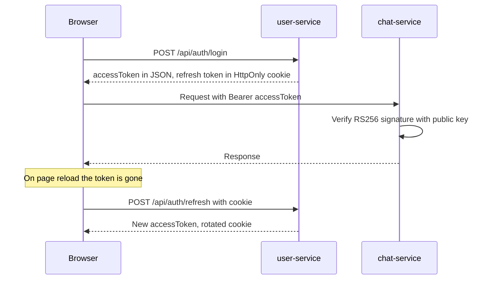

# Client and backend integration

How the browser talks to the services. The client calls one HTTPS origin, and Nginx routes each path. Backend hostnames never reach browser code.

## Paths

| Browser path | Service |
| --- | --- |
| `/api/auth/*`, `/api/accounts/*`, `/api/social/*` | user-service |
| `/api/chat/*` | chat-service REST |
| `/api/chat/socket.io/` | chat-service Socket.IO |
| `https://localhost:9443/...` | MinIO, using signed URLs only |

The `/api/chat/` location is more specific than `/api/`, so Nginx sends it to chat-service. Full routing is in [infrastructure](../services/infrastructure.md).

## Session

- The access token lives only in React state in `AuthProvider`. It is never written to storage.
- On load, `AuthProvider` calls refresh, except on `/login`, `/register`, `/forgot-password`, `/reset-password` and `/verify-email`.
- `requestWithSession` runs a request and refreshes on expiry. Concurrent refreshes share one promise, because refresh tokens rotate and a second use would look like token reuse.
- Nginx rewrites the cookie path from `/auth/` to `/api/auth/`.

## Realtime

The client opens a Socket.IO connection to namespace `/chat` with the access token in `auth.token`. The chat workspace and the feed each open their own connection while they are on screen. Each one refreshes the session if the server answers `Unauthorized`.

New messages arrive as `message:created` and are merged into the query cache by `id` or `clientRequestId`, which prevents duplicates when the HTTP response and the socket event both arrive. Polling covers missed events. Event names are in [chat-service](../services/chat-service.md).

## Errors

The API clients in `lib/` turn HTTP status codes into user-facing messages and raise `AuthRequestError`, which carries `status`. Components branch on `status`, for example to show "This reset link has expired" on 401.

## Where each merging point is documented

| Merging point | Document |
| --- | --- |
| Accounts, tokens and profile sync | [user-chat](user-chat.md) |
| Files | [chat-storage](chat-storage.md) |
| Feed | [feed](feed.md) |
