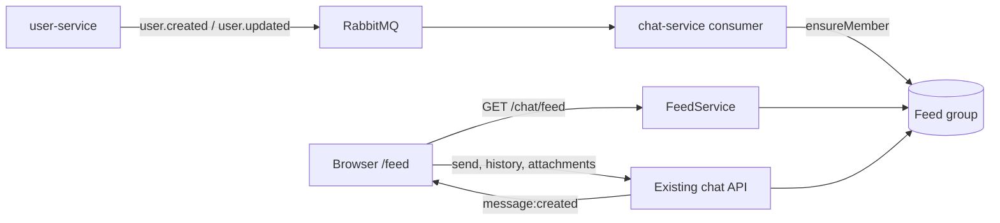

# Feed integration

The feed has no service of its own. It is one public group with one channel in chat-service, presented as posts by the client, with membership driven by user-service events. A post is a normal `Message`.

## Why it is built this way

Sending, history, pagination, idempotent retries, attachments, edits, deletes and live delivery already existed in chat. Building the feed on them needed no schema migration. The cost is that the feed inherits chat's limits.

## Provisioning

`src/feed/feed.constants.ts` holds two fixed UUIDs, one for the group ("Nook Feed") and one for its `general` channel.

| Step | Where | When |
| --- | --- | --- |
| Create group and channel | `FeedService.ensureFeed` | App bootstrap, and before any join. A failure is not cached, so it retries. |
| Add existing users | `FeedService.backfillMembers` | App bootstrap, in batches of 1000 |
| Add new users | `UserEventsConsumer.applyEvent` | On `user.created` and `user.updated` |
| Add the current caller | `GET /chat/feed` and `GET /chat/feed/users/:userId/posts` | Lazy safety net |

The consumer can start before bootstrap finishes, so every join waits for the feed rows to exist. Otherwise an early event would fail on the foreign key and requeue. Deleted users are not joined. A failure during bootstrap is logged and does not stop chat.

## Isolation from normal chat

- `GroupsService.getGroups` excludes the feed, so it never appears in the chat sidebar.
- `removeMember` rejects the feed group, so nobody can leave or be removed.
- The group has no admin, so editing, deleting and managing it are all rejected.

## Client

| File | Role |
| --- | --- |
| `components/app/feed/feed-view.tsx` | `/feed` page, history, socket, "Load older posts" |
| `components/app/feed/feed-composer.tsx` | Text, photo and video upload, progress, Ctrl+Enter |
| `components/app/feed/post-card.tsx` | One post as a card, with edit and delete for the author |
| `components/app/feed/profile-posts.tsx` | The Posts tab on a profile |

The feed shares its query key shape with the chat workspace.

## Limits

- **Text is required.** The send DTO needs 1 to 2000 characters, so a post cannot be media only.
- **No likes or comments.** The `Reaction` table is unused and there is no reply column.
- **No moderation.** Only the author can delete a post.
- **Blocks are not applied.** Blocked users can see each other's posts.
- **Edits and deletes are not live.** Others see them on the next refetch, about 60 seconds on the feed.
- **Fan-out cost.** Each post loads all members and emits to one room per member, which is O(users).
- **Presence side effect.** Presence audience comes from shared group membership, and every active user is in the feed. Each status change therefore goes to all users, and each connect snapshot lists all users. This is fine at demo scale. Excluding the feed group in `PresenceAudienceService` would restore the old audience.
- **Global, not following-based.** The product plan describes a chronological following feed. This one shows everyone.
