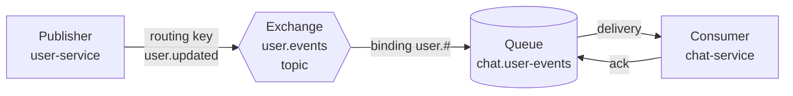

# User and chat integration
 
Everything that connects user-service and chat-service. Most of it is the RabbitMQ profile sync, so this is also the full RabbitMQ guide: a primer, the implementation, infrastructure, a hands-on lab and evaluation Q&A. The other links, shared JWTs and block checks, are in [section 13](#13-the-other-links-between-the-two-services). Written from the code as of November 2026.

---

## 1. Why RabbitMQ exists in this project

Two services need the same fact: **who a user is**.

- `user-service` owns accounts (email, password, username, avatar...).
- `chat-service` needs username, display name and avatar to render messages, group members and DMs, and to join them in SQL against its own database.

Options:

| Option | Problem |
| --- | --- |
| Chat calls user-service over HTTP on every request | Slow, and chat breaks whenever user-service is down |
| Chat reads the user database directly | Couples the services; breaks the microservice rule that each service owns its data |
| **User-service publishes events, chat keeps a local copy** | Chosen. Chat is fast and independent. The price is *eventual consistency*: the copy can lag briefly |

The local copy is the `ChatUser` table in chat-service. RabbitMQ is the pipe that keeps it up to date.

## 2. Primer: the five RabbitMQ words you need



- **Publisher / producer**: sends a message. It never talks to the consumer directly.
- **Exchange**: the router. Publishers send to an exchange, never to a queue. Ours is `user.events`, type **topic**, so routing uses patterns on the *routing key*.
- **Routing key**: a label on the message, here the event type: `user.created`, `user.updated`, `user.deleted`.
- **Binding**: a rule connecting an exchange to a queue. Ours: `user.#`. In topic patterns `*` matches exactly one word and `#` matches zero or more words, so `user.#` matches every `user.something`.
- **Queue**: the buffer that holds messages until a consumer takes them. **Durable** queues survive a broker restart.
- **Acknowledgement (ack)**: the consumer telling the broker "I handled it, you can delete it". No ack, or a **nack**, means the broker may redeliver.

Two independent reliability mechanisms, which people often confuse:

| Mechanism | Direction | Meaning |
| --- | --- | --- |
| **Publisher confirm** | broker to publisher | "I received and took responsibility for your message" |
| **Consumer ack** | consumer to broker | "I finished processing this delivery" |

Persistence: a message is only written to disk if it is published as `persistent: true` **and** the queue is durable. We do both.

Delivery guarantee: RabbitMQ with acks gives **at-least-once** delivery. A message can arrive twice (for example, the consumer crashes after writing to the DB but before acking). So consumers must be **idempotent**. See section 5.

## 3. The topology in this project

| Setting | Value |
| --- | --- |
| Broker image | `rabbitmq:4-management` |
| Exchange | `user.events`, type `topic`, durable |
| Queue | `chat.user-events`, durable |
| Binding | `user.#` |
| Routing key used when publishing | the event type (`user.created` etc.) |
| Publisher options | persistent messages, confirm channel, 5 s publish timeout |
| Consumer options | manual ack (`noAck: false`), `prefetch(1)` |
| Connection | heartbeat 30 s, reconnect every 2 s (via `amqp-connection-manager`) |

Both services declare the exchange, queue and binding on startup (`assertExchange`, `assertQueue`, `bindQueue`). Declaring is idempotent as long as the arguments match. This is why startup order does not matter: whichever service connects first creates the topology.

`prefetch(1)`: the consumer holds at most one unacknowledged message at a time. Messages are therefore processed strictly one after another per consumer.

The "heartbeat" is a TCP-level liveness check between a service and the broker. It has nothing to do with a user being "online" in chat.

## 4. The code, file by file

Read in this order.

### 4.1 Event shapes: `user-service/src/events/user-event.types.ts`

Every event is an envelope:

```json
{
  "eventId": "uuid-v4",
  "eventType": "user.updated",
  "version": "2026-11-03T10:00:00.000Z",
  "occurredAt": "2026-11-03T10:00:00.020Z",
  "data": { "userId": "uuid", "username": "...", "displayName": null, "avatarUrl": null }
}
```

- `eventId`: unique per event; also used as the AMQP `messageId`. Chat does **not** store it, so it is not used for deduplication.
- `version`: for created/updated it is the user row's `updatedAt`. It is a **timestamp used for ordering, not a counter**.
- `occurredAt`: when the publisher built the envelope.
- `data`: a **full snapshot** of the public profile, not a diff. For `user.deleted` it is only `{ userId }`.

No email, password or global role ever travels over the broker.

### 4.2 Publisher: `user-service/src/events/rabbitmq-events.service.ts`

- `onModuleInit` builds the URL from `RABBITMQ_HOST/PORT/DEFAULT_USER/DEFAULT_PASS`, connects with `amqp-connection-manager` (auto-reconnect), and creates a **confirm channel** named `user-events-publisher`. The `setup` function declares the exchange, queue and binding every time the channel (re)connects.
- `publishCreated`, `publishUpdated` build the envelope with `version = user.updatedAt`. `publishDeleted` uses the current time for `version` and `occurredAt`.
- `publish()` does `channel.publish(exchange, routingKey = eventType, Buffer(JSON), { persistent: true, contentType, messageId: eventId, timestamp })`. The returned promise resolves once the broker confirms, or rejects after 5 s.
- The connection-failure log deliberately does not print the URL, because it contains the password.

Who calls it (all `await this.events?.publishX(...)` *after* the DB write):

| Event | Call sites |
| --- | --- |
| `user.created` | `auth.service.ts` lines ~91, ~194, ~332 (register, OAuth paths); `superadmin.service.ts` ~136 |
| `user.updated` | `accounts.service.ts` ~267, ~329, ~398 (profile edit, avatar); `superadmin.service.ts` ~165; `auth.service.ts` ~891 |
| `user.deleted` | `accounts.service.ts` ~298; `superadmin.service.ts` ~191 |

Note the `?.`: `events` is optional, so tests can run without a broker. Editing a row by hand in the DB publishes nothing.

### 4.3 Consumer contract: `chat-service/src/events/user-event.ts`

`parseUserEvent` is a hand-written validator. It requires a UUID v4 `eventId` and `userId`, parseable dates, and the right field types. Anything else returns `null`, and the consumer discards it. Unknown event types are dropped too, even though the `user.#` binding would deliver them.

### 4.4 Consumer: `chat-service/src/events/user-events.consumer.ts`

Setup (lines ~56-78): same connection options, a channel with `confirm: false` (consumers do not need confirms), declare topology, `prefetch(1)`, then `consume(queue, handler, { noAck: false })`.

Handler `consume()` (lines ~88-112):

| Situation | Action |
| --- | --- |
| Body is not valid JSON | log warning, **ack**, discard |
| Fails `parseUserEvent` | log warning, **ack**, discard |
| `applyEvent` succeeds (including "ignored as stale") | **ack** |
| `applyEvent` throws (DB down, etc.) | `nack(message, false, true)` = **requeue** |

Discarding bad messages with an ack is intentional: a malformed message will never become valid, so requeuing it would loop forever.

`applyEvent()` (lines ~114-145), the heart of it:

1. Build the profile fields. For `deleted`: username, displayName and avatarUrl become `null` and `deletedAt = occurredAt`. Otherwise copy the snapshot and `deletedAt = null`.
2. `chatUser.updateMany({ where: { id, sourceUpdatedAt: { lt: version } }, data })`. This only updates if the stored version is **strictly older**.
3. If nothing was updated, `chatUser.createMany({ data, skipDuplicates: true })`. This inserts if the row is missing, and does nothing if it already exists with an equal or newer version.
4. For `created` and `updated` events, `FeedService.ensureMember` joins the user to the global feed. If this throws, the event is requeued like any other failure. See [feed](feed.md).

## 5. Ordering, duplicates and deletes: why it is correct (mostly)

Because every event carries a full snapshot and a `version`, the rule is "newest version wins":

| Existing local state | Incoming event | Result |
| --- | --- | --- |
| no row | created or updated | insert |
| older version | newer profile event | replace, advance version |
| same version | duplicate delivery | no-op (**idempotent**) |
| newer version | older, delayed event | no-op (cannot go backwards) |
| no row or older | deleted | insert or update a tombstone |

Consequences:

- An `updated` arriving before its `created` still creates the row.
- A `deleted` arriving first creates a **tombstone**, and a late `created` cannot resurrect it.
- Redelivery after a crash is harmless.

**Deletion is soft.** `user.deleted` does not delete the row. It blanks the profile and sets `deletedAt`, so existing messages, DMs and memberships keep a valid foreign key. A newer profile event can clear `deletedAt` again (not terminal). The consumer does **not** remove memberships, kick sockets or revoke JWTs. Chat's guards (`EnsureActiveUserGuard` etc.) enforce `deletedAt` at request time.

## 6. The HTTP fallback

`chat-service/src/chat/user-profiles.service.ts` has `ensureActiveUsers(ids)`. It is called when creating a DM, when adding a group member, and on every `/chat` request through `EnsureActiveUserGuard`, for the caller. It:

1. finds which requested users are missing from `ChatUser`,
2. fetches only those through `GET /accounts/:id` on `USER_SERVICE_URL`,
3. inserts them (`skipDuplicates`), using `createdAt` as `sourceUpdatedAt`,
4. checks every requested user has `deletedAt = null`.

Errors: unknown account gives 404; user-service unreachable or invalid response gives 503. It only fills *missing* rows. It never refreshes existing ones and never discovers a deletion whose event was lost.

## 7. Known limitations (be honest about these in the defense)

1. **No transactional outbox.** The DB commit and the publish are two separate operations. If user-service crashes between them, or the publish fails, chat never learns of the change. Publisher confirms do not close that gap. In `register`, the publish is awaited inline, so a broker failure after the user row is created surfaces as an error to the client even though the account exists.
2. **No retry cap, delay queue or dead-letter queue.** A permanently failing event (nack + requeue) is retried immediately and forever.
3. **Race on first insert.** `updateMany` then `createMany` is two statements without a transaction. With multiple consumers, or the HTTP fallback running concurrently, an older event could insert first and cause a newer one to be skipped.
4. **No `eventId` dedupe.** Idempotency relies only on timestamp comparison, so two different events with the same `version` are resolved first-come.
5. **Repair path missing.** There is no reconciliation job that re-syncs profiles after a missed event.

A defensible answer for each: "known, acceptable for the project scope, and here is the production fix" (outbox table plus relay for 1, DLQ plus retry TTL for 2, a transaction or `INSERT ... ON CONFLICT DO UPDATE ... WHERE` for 3, reconciliation endpoint for 5).

## 8. Infrastructure

`compose.yaml` service `rabbitmq`:

- image `rabbitmq:4-management`, hostname `rabbitmq`
- credentials from `envs/rabbitmq.env` (`RABBITMQ_DEFAULT_USER`, `RABBITMQ_DEFAULT_PASS`). They are created **only on first initialization of the data dir**. Editing the env file later does not change the broker's user. Delete `volumes/rabbitmq` to reinitialize.
- ports bound to localhost only: `127.0.0.1:5672` (AMQP) and `127.0.0.1:15672` (management UI)
- data volume `./volumes/rabbitmq:/var/lib/rabbitmq` (this is what makes durable queues survive `docker compose down`)
- `infra/rabbitmq/enabled_plugins` mounts `[rabbitmq_management,rabbitmq_prometheus].`, which turns on the UI and metrics on port 15692 (internal)
- healthcheck `rabbitmq-diagnostics -q ping`
- `user-service` and `chat-service` both `depends_on: rabbitmq: service_healthy` and load `envs/rabbitmq.env`. Chat also reads `RABBITMQ_HOST=rabbitmq`, `RABBITMQ_PORT=5672` from `envs/chat-service.env`.

## 9. Monitoring

Alloy scrapes the RabbitMQ Prometheus endpoint (:15692) every 15 s. The "Databases & Broker" Grafana dashboard shows connections, queue depth, unacked messages and message rates. Two alerts live in `infra/monitoring/prometheus/alerts.yml`:

| Alert | Fires when | Usually means |
| --- | --- | --- |
| `RabbitMQQueueBacklog` | more than 100 `ready` messages for 5 min | chat-service consumer is down or too slow |
| `RabbitMQUnackedHigh` | more than 50 `unacked` messages for 5 min | consumer is stuck mid-processing |

Mapping to this design: `ready` = waiting in the queue; `unacked` = delivered but not yet acked. With `prefetch(1)` unacked should normally be 0 or 1.

## 10. Hands-on lab (15 minutes, do this before the defense)

Open the management UI at `http://127.0.0.1:15672` and log in with the credentials from `envs/rabbitmq.env`.

1. **See the topology.** Exchanges tab: find `user.events` (type topic, durable). Queues tab: find `chat.user-events`. Click the exchange and check the binding `user.#`.
2. **Watch a message flow.** Register a user in the app. In the Queues tab, watch the message rates graph tick. Check chat-db: `SELECT * FROM "ChatUser" ORDER BY "sourceUpdatedAt" DESC LIMIT 3;`
3. **Prove durability and buffering.** `docker compose stop chat-service`, then edit your profile or avatar a few times. In the UI the queue shows *Ready* going up. `docker compose start chat-service` and *Ready* drains to 0 and the profile appears. This is the best demo of why we use a broker.
4. **Prove idempotency.** In the queue's "Publish message" box on the exchange, send a `user.updated` JSON with an *older* `version` for an existing user, then check the row did not change.
5. **Prove poison handling.** Publish `{"hello":1}` to the exchange with routing key `user.updated`. The chat logs show "Discarded invalid user event", and the queue stays empty.
6. **Break the broker.** `docker compose stop rabbitmq`, then try to register. Observe the failure mode (section 7, limitation 1). Start it again and watch the services reconnect (the 2 s reconnect logs).

## 11. Evaluation Q&A

**Why a message broker instead of REST between the services?**
Decoupling and resilience. Chat renders names and avatars from a local table instead of making network calls per request, and events buffer while chat is down (lab step 3). Be precise about the limit: group chat and history keep working if user-service is down, but opening a DM or sending in one returns 503 because those need the block check (section 13).

**What happens if RabbitMQ is down?**
Publishers retry the connection every 2 s. Publishing times out after 5 s and the calling request errors. Chat keeps serving from its local copy and the HTTP fallback fills missing users for DMs. Events published during the outage are lost (no outbox), which is the main known gap.

**What happens if the same event is delivered twice, or out of order?**
Nothing bad. The version comparison makes processing idempotent and order-independent for profile data.

**Why topic exchange and `user.#` instead of a direct queue?**
It lets another service (notifications, for example) bind its own queue to `user.events` and get the same events, with no change to the publisher. Adding a consumer means adding a queue and a binding.

**Why ack manually?**
So the message is only removed after the DB write succeeds. With auto-ack, a crash mid-processing would lose the event.

**Why do bad messages get acked but DB errors get requeued?**
A malformed message is permanently bad, and requeuing it would loop forever. A DB error is probably transient, so retry makes sense. (The missing retry limit is a known weakness.)

**What is the difference between publisher confirms and consumer acks?**
Confirm: broker tells publisher it accepted the message. Ack: consumer tells broker it finished processing. They protect different hops.

**What is eventual consistency here?**
For a short window (milliseconds to seconds, longer if chat is down) a username change is visible in user-service but not yet in chat.

**Why soft delete?**
Messages and memberships still reference the user id. A hard delete would break foreign keys or force deleting other people's conversation history.

**What would you improve with more time?**
Transactional outbox in user-service, a dead-letter queue with delayed retries, a reconciliation job for missed events, and `INSERT ... ON CONFLICT` for the consumer upsert.

## 12. Cheat sheet

```
user-service  --publish(confirm, persistent)-->  exchange user.events (topic)
                                                    | binding user.#
                                                    v
                                              queue chat.user-events (durable)
                                                    | prefetch(1), manual ack
                                                    v
chat-service  parse -> validate -> updateMany(version < v) else createMany(skipDuplicates) -> ack
              bad message -> ack+discard      DB error -> nack+requeue
```

Remember: at-least-once delivery, idempotent consumer, newest `version` wins, soft delete with a tombstone, HTTP fallback for the gap, and no outbox (the known limitation).

## 13. The other links between the two services

| Link | Direction | Used for | If it fails |
| --- | --- | --- | --- |
| RabbitMQ `user.events` | user-service to chat | Profile copies, feed membership | Events buffer while chat is down. Events published while the broker is down are lost. |
| Shared JWT | user-service signs, chat verifies | Identity on every request and socket | Chat cannot verify without the matching public key |
| `GET /accounts/:id` | chat to user-service | Fill a missing `ChatUser` | 404 for an unknown user, 503 if unreachable |
| `GET /social/blocks/check/:userId` | chat to user-service | Block check for DMs | 503 if unreachable, 403 if blocked |

### Shared JWT

user-service holds the RSA private key and signs access tokens. chat-service holds only the public key in `JWT_PUBLIC_KEY`. It checks the signature, `RS256`, issuer `user-service`, audience `ft-transcendence-api`, a UUID `sub` and `exp`. Users never log in to chat separately. Because chat has no private key, a compromise of chat cannot mint tokens.

### Block checks

Blocks live in user-service. `UserProfilesService.ensureCanContact` forwards the caller's own `Authorization` header to `GET /social/blocks/check/:userId`, with a 3-second timeout. It runs when opening a DM and whenever a DM conversation is accessed with a token, such as sending. Group channels and the feed do not check blocks.

### Ownership

| Data | Owner | Chat's view |
| --- | --- | --- |
| Accounts, credentials, global role | user-service | Never copied |
| Public profile | user-service | `ChatUser`, eventually consistent |
| Friendships, blocks | user-service | Asked over HTTP when needed |
| Conversations, messages, group roles, presence | chat-service | Owner |

`ChatUser.id` equals the user-service UUID. There is no foreign key across the two databases.
