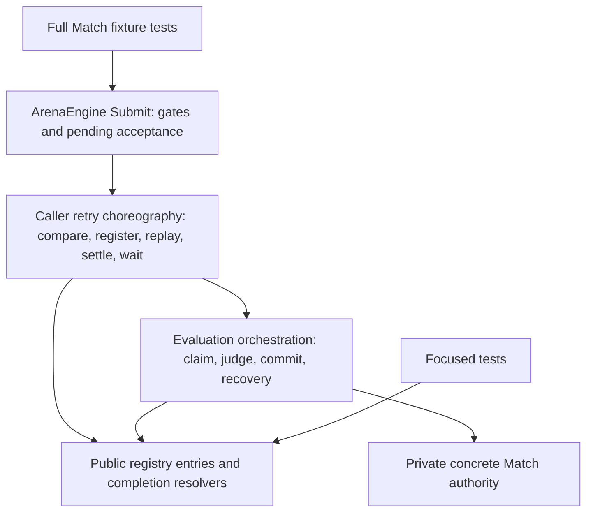
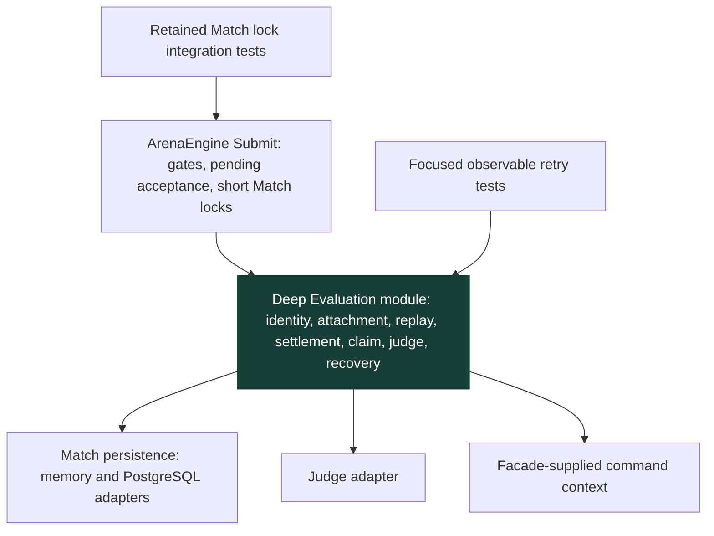

# Code Arena: deepen Evaluation retry ownership

Date: 2026-10-08
Status: Implemented on 2026-10-08; completion recorded on 2026-10-09
Repository: `/Users/ayousr/Documents/ft-transcendence`
Branch: `Aimane`
Reviewed revision: `832aa8dcac774af774bea6dc4101fcdd330df044`

**Completed: immutable Evaluation retry ownership now lives in the Evaluation orchestration module.** Commits `016612f`, `fdf4900`, `6a1d99b`, and `c1ecea0` implemented the structural command context, retry completion ownership, private bookkeeping, and accepted Evaluation identity validation. See the [ADR-0012 ownership clarification](../adr/0012-evaluation-and-judge-adapter-deepening.md#ownership-clarification-2026-10-08).

The survey evidence, rankings, and proposed shape below describe revision `832aa8d` before implementation. They are retained as historical rationale, not outstanding work. The implemented revision is `c1ecea06f27fef9d20fa04cd95aad660cf4f27fc`.

## Coverage and method

Ranked **271 historical file paths by churn** across **28 commits** since 2025-10-08. Normalized detected renames to rank **163 current TypeScript source/test files**. Read **80 distinct source/test files across four areas**, with three parallel area surveys and a main-session judging survey. Inspected declarations and references in **seven additional browser-test files**; those seven were not fully read.

Read `AGENTS.md`, `CONTEXT.md`, `packages/README.md`, relevant ADRs, and the retained judging decision before their respective code areas. Use `CONTEXT.md` as the domain glossary. Follow the repository's `docs/` documentation home and package entry-point convention.

| Area | Source/test files fully read | Surviving candidates |
| --- | ---: | ---: |
| Match authority, Match persistence, Team collaboration, Evaluation orchestration | 23 | 1 |
| Lobby, Team chat, Game transport callers | 20 | 0 |
| Frontend Arena transport, Lobby reconciliation, live clients, immediate UI callers | 20 | 0 |
| Judge adapters, worker queue, readiness, HTTP transport, provider selection | 17 | 0 |

The churn ranking includes the game import (`15070ed`) and package entry-point migration (`ec0894d`). Exclude those bulk changes when assessing repeated conceptual co-change. No repeated source-to-source co-change pair survives that exclusion, so history does not support a separate poor-locality finding. The short post-import history limits the strength of that conclusion.

The prior proposals have landed: atomic document revision checks, one Match persistence constructor seam, isolated Lobby hints, the Lobby command module, the Team chat module, and deliberate package entry points. The current survey does not re-propose that completed work.

## Ranked candidates

| Rank | Candidate | Pattern | Strength | Expected blast radius |
| --- | --- | --- | --- | --- |
| 1 — recommended | Deepen immutable Evaluation retry ownership | Untested coupling | moderate | Four source/test files; one production caller |

No runners-up survive both gates.

## 1. Deepen immutable Evaluation retry ownership

### Problem and evidence

Evaluation orchestration owns judge execution, recovery, durable claims, and verdict settlement, but its caller still coordinates local retry bookkeeping. The supported Evaluation entry point also requires a private concrete Match authority in its construction options. Focused tests exercise the registry rather than the complete workflow.

| Evidence | Location |
| --- | --- |
| ArenaEngine compares eight identity fields against both local and durable Evaluation state, registers ownership, replays failures, and settles early outcomes | `packages/arena-game/src/lib/engine.ts:554–605` |
| ArenaEngine settles setup errors and waits for duplicate completion after leaving the Match lock | `packages/arena-game/src/lib/engine.ts:663–675` |
| The public run input includes caller-owned tracked state with a completion resolver | `packages/arena-game/src/lib/evaluation-orchestration.ts:33–36,96–112` |
| The orchestrator forwards registry operations to its internal registry | `packages/arena-game/src/lib/evaluation-orchestration.ts:168–188` |
| Construction requires concrete MatchAuthority alongside the existing facade host seam | `packages/arena-game/src/lib/evaluation-orchestration.ts:140–151` |
| The supported root entry point exposes authority errors, but does not export MatchAuthority | `packages/arena-game/src/index.ts:11–14` |
| The focused Evaluation test file covers only registry bookkeeping | `packages/arena-game/test/evaluation-orchestration.test.ts:1–74` |
| Full retry behavior has integration coverage through ArenaEngine and a complete Match fixture | `packages/arena-game/test/submit-path.test.ts:48–150`; `packages/arena-game/test/setup.ts:52–75` |

The issue is the cost of the interface: callers must learn get/compare/track/settle ordering and carry completion ownership across an asynchronous workflow. A test cannot construct the supported Evaluation module with a lightweight authority adapter without depending on the private class or bypassing its type contract. Existing integration tests protect important behavior; they do not provide a focused Evaluation test surface.

### Proposed shape

Put immutable identity comparison, retry attachment, settlement, failure replay, and receipt lookup behind the existing Evaluation orchestration interface. Keep registry entries and completion resolvers inside its implementation. Obtain the necessary short-command context through the facade seam rather than requiring private Match-authority construction.

Keep trusted membership, Readiness, frozen Team collaboration source selection, pending Submission acceptance, and Match locking with their existing owners. Preserve short locked acceptance and commit phases, with duplicate waits and judge work outside those locks. Reuse the current claim-session commit protocol.

This proposal describes ownership and observable outcomes. Choose the concrete interface during the follow-up interview; no method names, signatures, or new generalized abstractions are prescribed here.

### Before

### After — proposed

### Why it is deeper

**Locality:** identity checks and completion rules concentrate with Evaluation recovery, which already maintains those identities and settles ownership. An added identity field or settlement fix has one workflow owner.

**Leverage:** callers receive a consistent retry outcome without coordinating registry entries. Focused tests exercise the same interface and ordering contract as production.

**Seam:** use the existing Evaluation workflow and facade command-context seam. Match persistence has two real adapters, memory and PostgreSQL. Judge behavior also has production and deferred test adapters. The proposal needs no speculative generic retry module.

### Both gates

**Deletion test — PASS.** Remove ArenaEngine's manual get/compare/track/settle/wait choreography and let the existing Evaluation orchestration module absorb it. Recovery already owns identity and settlement there (`evaluation-orchestration.ts:299–378,525–535`), so complexity concentrates in its proper owner rather than relocating to a new helper.

**Interface as test surface — PASS.** Exercise same-identity attachment, changed-identity rejection, original receipt/error replay, and completion after a persistence failure through the deepened supported Evaluation interface. Use memory persistence, a deferred judge adapter, and a facade-context test adapter. Assert returned outcomes, recorded submissions, judge invocation count, and completion. Do not inspect registry entries or import private Match authority. Retain ArenaEngine integration checks for lock release and independent progress by the other side.

These are proposal gate judgments, not newly executed test results.

### Strength and expected blast radius

**Moderate.** ArenaEngine has five rename-normalized changes in the sampled history. Evaluation orchestration has two, representing the bulk import and entry-point move. Both gates pass, but that history does not justify a strong badge for the whole candidate.

Expect to change exactly these four files for the proposed move:

1. `packages/arena-game/src/lib/engine.ts` — replace retry bookkeeping in Submit with delegation.
2. `packages/arena-game/src/lib/evaluation-orchestration.ts` — own attachment and settlement sequencing; make construction testable through supported seams.
3. `packages/arena-game/src/evaluation-orchestration.ts` — expose the deliberate supported workflow and keep registry bookkeeping private.
4. `packages/arena-game/test/evaluation-orchestration.test.ts` — replace registry-only assertions with observable workflow tests.

One production caller changes: `ArenaEngine.submit`. Boot recovery changes internally in Evaluation orchestration. Run the existing `submit-path.test.ts`, `concurrency.test.ts`, `reconnect.test.ts`, `deadline-closure.test.ts`, `post-commit-events.test.ts`, `match-revision.test.ts`, and `postgres.test.ts` as regression coverage; their presence does not imply that all need editing. Update relevant authoritative documentation only if the final design changes a recorded decision.

### Existing decisions

This proposal is compatible with **ADR-0004**, **ADR-0011**, and **ADR-0012**. Preserve Match persistence ownership, immutable Evaluation identity, short Match locks, detached retry waits, durable claim ownership, and claim-session verdict commits. Preserve **ADR-0007** and **ADR-0008** ownership of Round lifecycle and Team collaboration. No superseding ADR is currently required.

## Implemented plan (historical)

The implementation resolved retry admission, completion ownership, failure replay, and the facade command-context responsibilities. The phases below retain the original planning and verification intent; they are no longer a build queue.

| Phase | Work | Check that proves the intermediate state |
| --- | --- | --- |
| 1. Fix the behavioral contract | Characterize the current retry outcomes and lock ordering through existing supported entry points. Select the focused construction seam during the interview. | Prove identical concurrent requests invoke one judge, changed identities reject, failures reach both callers, and another side can progress while judging waits. |
| 2. Enable focused Evaluation construction | Remove the private concrete-authority construction requirement using the agreed facade context. Keep the existing workflow behavior. | Construct and exercise the Evaluation module using only supported entry points, memory persistence, and test adapters. Check package import rules and typechecks. |
| 3. Concentrate retry ownership | Move identity, attachment, replay, and settlement sequencing into Evaluation orchestration. Keep authorization and pending acceptance under their current short Match lock. | Run focused retry tests and the retained Submit/concurrency/deadline/reconnect tests. Verify pending writes that fail settle waiting callers and emit no uncommitted gameplay event. |
| 4. Close the public bookkeeping seam | Keep registry entries/resolvers private and replace their external tests after equivalent workflow checks exist. Review the complete diff. | Run package checks and relevant builds. Run PostgreSQL claim/recovery regression checks against a disposable database. Verify failed or stale claim owners cannot commit and ordinary revision checks remain intact. |

## Completion

The original candidate is implemented. Future reviews should inspect the current supported Evaluation workflow and its behavior tests rather than re-suggesting caller-owned retry bookkeeping. The [implementation plan](../plans/2026-10-08-evaluation-retry-ownership.md) and ADR-0012 preserve the decision trail.

The original survey itself was read-only and wrote this Markdown proposal. Implementation happened afterward in the four commits recorded above.
