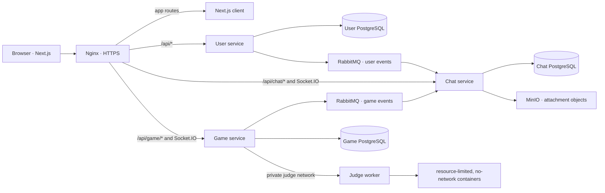

# Code Arena integration specification

**Status:** Integrated; automated verification and live demonstration evidence are tracked separately.
**Updated:** 2026-11-12
**Decision:** [ADR-0015](../adr/0015-code-arena-nook-integration.md)

## Product behavior

Code Arena is Nook's first playable game. Signed-in users can find a 1v1 match, create or join a six-character private room, challenge another user from a direct conversation or profile, or form a 2v2 team. A match has three coding rounds under one 30-minute match budget, automated hidden-test evaluation, score reveals and a final result. Default matchmaking currently selects three seeded problem versions without repetition; the small pool is intentional for this release, with a larger author-owned 42 Network-inspired catalog deferred.

Within a round, a team's latest completed scored submission is counted, including when it scores lower than an earlier submission. A pending evaluation does not replace the previous counted result. Once both teams have a completed scored submission, the round reveals and closes, so neither team can replace its result afterward. The match winner is decided by total score, then lower summed elapsed time for the counted submissions, then fewer counted submissions; if all three values tie, the result is a draw.

The 2v2 mode gives each team a shared CodeMirror/Yjs editor, readiness gates and match-scoped team chat. One player may leave while their teammate keeps playing and submits alone. A disconnected teammate retains their approval during a 90-second reconnect window; after it expires the remaining player may submit alone. A returning teammate must approve the current document revision again. If every player on a team is unavailable, that team forfeits after 90 seconds of whole-team unavailability. Team surrender is an explicit unanimous vote from the currently participating teammates; after the teammate leaves or their reconnect window expires, the remaining player may decide alone. Match recovery and socket presence are owned by the Game service.

The profile Games tab displays recent completed matches, a played/wins/win-rate summary, player progression (level, XP, rank title), and six unlockable achievement badges; `/play/leaderboard` ranks players by wins, then win rate and matches played, with level indicators.

Direct-message invitations are ordinary persistent Chat messages with a recognized Code Arena card. Opening a card routes to the room; the card queries `GET /api/game/lobby/rooms/lookup/:code` to render a live status badge (`Open`, `In Match`, or `Expired`), links directly to active matches, or disables expired rooms.

Game lifecycle notifications are separate from the invitation card. The Game service publishes authoritative match events on the `game.events` RabbitMQ exchange; the Chat service consumes them and writes ordinary system messages (`kind = SYSTEM`) into the conversation that carries the challenge: one message when the match starts, one when it ends (win, draw, forfeit or deadline) and one when a challenge is cancelled before it starts. The invitation message carries the private-room code, and Chat asks the Game service whether the sender may announce that room before it links the room to a conversation: the Game service refuses a non-member with `403`, and only the account that created the room may publish its invite code. The Game service publishes without blocking gameplay, and it publishes its events in order, so a start is never announced after its result. Delivery is best effort over the broker: there is no transactional outbox, so an event the broker never confirms is lost, while events that were published are durable while Chat is down. See [the Chat service notes](../services/chat-service.md#code-arena-lifecycle-notifications).

## Service boundaries

Nginx maps `/api/game/` to the Game HTTP service and `/api/game/socket.io/` to its Socket.IO transport. The legacy `/socket.io/` location continues to route to Chat, so the lobby and game clients must provide the canonical Game socket path. The Game service validates User-issued RS256 JWTs and uses `sub` as the stable user ID. Public usernames and avatars are hydrated from the User API in the client.

The Game service persists state in its own PostgreSQL database using atomic match snapshots and associated round, submission and collaboration records. Judge execution uses a bounded in-process queue and the isolated worker. Redis is not a runtime dependency in the current implementation.

## HTTP and realtime contracts

- `/api/game/lobby/*`: authenticated matchmaking, private-room creation/joining, readiness and room state.
- `/api/game/matches/*`: authenticated match snapshots, coding actions, runs, submissions, readiness, leaving and team surrender (`POST /:id/surrender`).
- `/api/game/users/:userId/matches`: authenticated, sanitized completed-match summaries for profile display.
- `/api/game/users/:userId/stats`: authenticated win/loss/draw and win-rate aggregates.
- `/api/game/leaderboard`: authenticated top-player summaries, limited to 50 players.
- `/api/game/socket.io/`: the shared Engine.IO transport path. The authenticated Socket.IO namespaces are the default `/` namespace for match state and `/collab`, `/chat`, and `/lobby` for Yjs collaboration, team chat, and room events.
- `/api/chat/*`: persisted direct conversations, including Code Arena invitation messages (`POST /api/chat/conversations/:id/messages` accepts `gameChallenge: { roomCode }` to link the challenge to its conversation) and the game lifecycle notifications written back into it.

The history response contains up to 25 recent matches, each with its ID, mode, outcome, opponents, score, and `playedAt` completion timestamp. Stats and leaderboard responses contain aggregate counts and win rate; leaderboard entries also contain rank. These responses do not contain source code, editor snapshots, or hidden tests. Game HTTP requests use same-origin paths and the authenticated access token; Socket.IO clients send the token in their authenticated handshake. The API returns no rating because this build has no rating system.

## Persistence and privacy boundary

The `game-db` owns match snapshots, private rooms, rounds, submissions, reveals and collaborative documents. Submitted source and editor snapshots may contain personal data and can be read by the instance operator. The durable `game.user-events` queue consumes `user.deleted` events from the User service. Game stores only a SHA-256 hash of the deleted account identifier for 20 minutes so unexpired access tokens are rejected across Game instances; an automatic sweep removes the hash within one additional minute. Authenticated HTTP and WebSocket handlers check this block, per-instance fanout disconnects existing sockets, and a 15-second socket sweep catches instances that missed live fanout during a broker interruption.

Erasure removes the account's matchmaking rows and private-room membership. If it owns a room, ownership transfers to the earliest remaining member; an empty room is deleted. Each affected active match ends by forfeit. The match result remains, but the participant identifier is replaced by a random anonymous identifier and marked `anonymized`; match snapshots expose `null` for that member ID, profile history omits anonymous opponent IDs and the leaderboard omits anonymous players. Game deletes all submitted source, run output, judge diagnostics and collaborative documents for the affected side, and removes that account's messages from the in-memory team-chat history. In 2v2, editor state and submissions are side-shared, so the entire side's code is removed even when the teammate contributed it. This deletion covers the live Game database; backups and copied volumes follow the instance operator's separate retention policy. See the [Privacy Policy](<../../client/app/(legal)/privacy/page.tsx>) and [Terms of Service](<../../client/app/(legal)/terms/page.tsx>).

## Verification

Automated checks are run from the repository root or `client/` as described in the [root README](../../README.md). In the default no-`DATABASE_URL` test setup, the Game HTTP integration tests cover principal-protected history, stats, and leaderboard responses with the development principal fixture and in-memory store. Account-erasure tests cover forfeit/anonymization, source and collaboration deletion, lobby cleanup, token-block expiry, and access denial on existing sockets. A separate unit test checks that default matchmaking selects three distinct problem IDs. Direct PostgreSQL persistence tests, including atomic source deletion, require `TEST_PG_URL` to point to a disposable test database. Alternatively, `npm run test:integration` starts disposable PostgreSQL and RabbitMQ containers, sets test connection URLs for the database/socket suites, and cleans up those containers when the run ends. Do not point direct tests at a database containing user data.

Game lifecycle notifications are covered at both sides of the contract. `services/game/src/game/game-events.test.ts` proves that the Game service publishes a match start (with the room code), a forfeit result, a withdrawn challenge and an expired challenge, that it reaches every expired challenge beyond the first page, that it republishes an expiry or a result the broker did not confirm, and that no event carries source, editor or hidden test data. `chat-service/test/game-notifications.spec.ts` and `chat-service/test/game-notifications.postgres.test.mjs` prove that Chat validates the event, refuses a challenge from an account that is not in the room, refuses a challenge from a room member that did not create the room, refuses to move a challenge to another conversation, keeps one message and one binding when two conversations claim a code at once, writes one persisted system message, ignores a replayed event, rejects participants who are not conversation members, and receives the event over RabbitMQ in the disposable integration environment. The notification suite starts the **real Game service** and asks it for the room, so an invented mock cannot hide a change in the room contract; `services/game/src/game/lobby.test.ts` locks the other side of that contract. `client/tests/arena-game-notifications.test.mjs` proves that only system messages are rendered as notification cards and that an invitation links its room code to the conversation. A live two-client browser demonstration on 2026-11-11 covered the same path in two independent sessions: the owner's invitation, the second account accepting it, the match-started notice, the match-result notice after a forfeit, the challenge-cancelled notice after a withdrawal and after an expiry; all were delivered live to both clients. Reloading preserved the five cards present at those checkpoints; the expiry notice arrived afterward, was received live and persisted once, but was not part of the reload check. Evidence: [docs/evidence/g06-live-demo](../evidence/g06-live-demo/README.md).

On 2026-11-12, a local four-client 2v2 run used one Game service instance. An Alpha teammate's edit appeared in the other Alpha client; the Beta clients kept their own shared document; both visible Alpha tests passed. The run did not complete a scored round or a match, so it establishes collaboration behavior only and no 2v2 result. The four dark screenshots are saved in `docs/book/assets/code-arena-live-2v2-*.png` and appear in the Nook Book. All four browser contexts ran on one computer, so this does not meet the separate-computer check for G02 or prove production deployment. ADR-0016 records the one-instance choice for the initial release.

The four-client local 2v2 run is recorded above. It supports the G03/W09 collaboration evidence — teammate edit synchronization, team document isolation and Alpha's two visible tests passing with output `10` — but it did not complete a scored round or a match, so no completed 2v2 result is claimed and demonstrating one remains outstanding. Be ready to repeat and explain the run during evaluation. G02 remains open until two clients on separate computers complete a match and recover from a disconnection. Live evaluator demonstrations are not replaced by unit tests or a successful container build.
