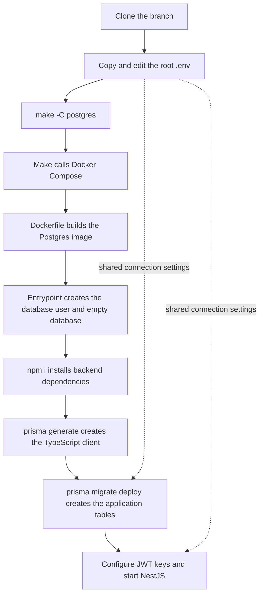

# Disposable PostgreSQL for testing

The root `user-service/.env` configures the database container, Prisma, and NestJS.
There is no JavaScript bootstrap, separate database env file, or persistent data
volume. You need Docker with Compose and GNU Make to start the database; npm
packages can be installed afterward.

## Team setup

```sh
git clone --branch user-service-test https://github.com/MliliGenes/ft-transcendence.git
cd ft-transcendence/user-service
cp .env.example .env
```

For an existing checkout, keep your existing `.env`. Set the database entries in
that root file:

```dotenv
POSTGRES_HOST=127.0.0.1
POSTGRES_PORT=5433
POSTGRES_USER=nook_test
POSTGRES_PASSWORD=choose-your-test-password
POSTGRES_DB=nook_users
```

Then run, in this order:

```sh
make -C postgres
npm i
npx prisma generate
npx prisma migrate deploy
```

`make` waits until Postgres is healthy before returning. The database is now ready
for the backend. Configure the JWT keys using [SETUP.md](../SETUP.md), then run
`npm run start:dev`.

Use `migrate deploy` to apply the migration files already in the branch. The word
`deploy` does not require a hosted environment. `npx prisma migrate` alone is a
command group: it needs a subcommand. Use `migrate dev --name your_change` when
working on a new schema change.

## How the pieces connect



| File | Responsibility |
| --- | --- |
| Root `.env` | Database connection settings shared by all three tools. |
| `Makefile` | Short commands for starting, stopping, and viewing logs. |
| `compose.yaml` | Reads `.env`, maps the port, and supplies temporary storage. |
| `Dockerfile` | Builds the Postgres image and sets its entrypoint/health check. |
| `entrypoint.sh` | Calls Postgres initialization to create the user and database. |
| `prisma/migrations/` | SQL changes that create and update application tables. |

Compose passes only `POSTGRES_USER`, `POSTGRES_PASSWORD`, and `POSTGRES_DB` into
Postgres. JWT and Discord settings stay out of the database container. The host
port comes from `POSTGRES_PORT`; the container's internal port is always `5432`.

## Start over whenever needed

| Command, from `user-service` | Action |
| --- | --- |
| `make -C postgres` | Build/start and wait until ready. |
| `make -C postgres status` | Show container health. |
| `make -C postgres logs` | Follow database logs. |
| `make -C postgres stop` | Stop the database and discard its data. |
| `make -C postgres down` | Remove the container and discard its data. |

The database uses `tmpfs` (temporary memory storage). Stopping the container,
recreating it, or shutting down Docker loses its tables and records. Running
`make` again while the same container is still running does not itself reset it.

After stopping/removing it, prepare a fresh database with:

```sh
make -C postgres
npx prisma migrate deploy
```

Dependencies and the generated Prisma client remain on your computer; you do not
need to reinstall/regenerate them for every database reset. To apply changed
credentials or a changed port from `.env`, run `make -C postgres down` first,
then start and migrate again.
